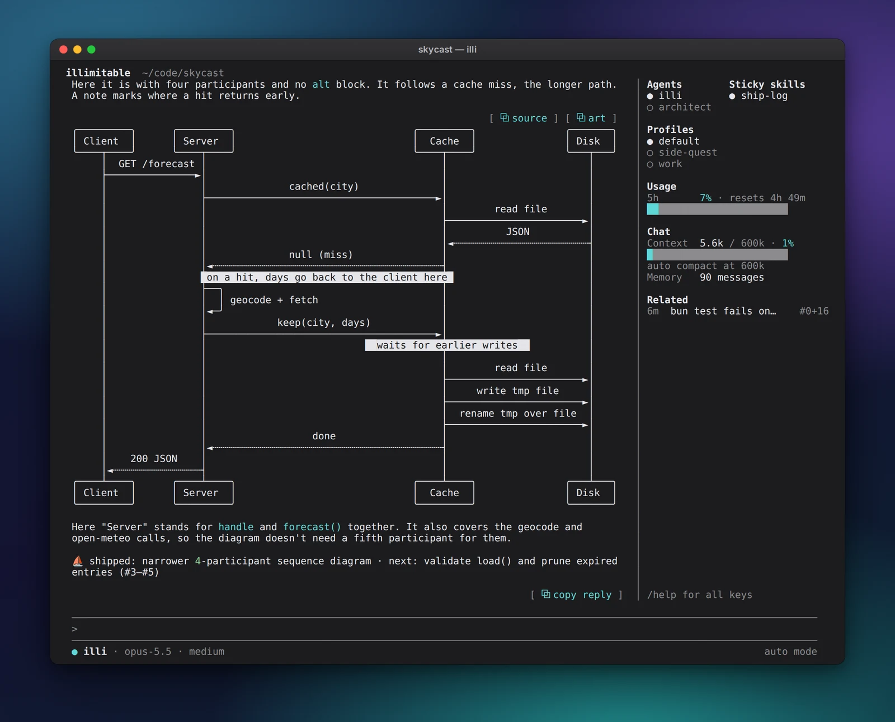
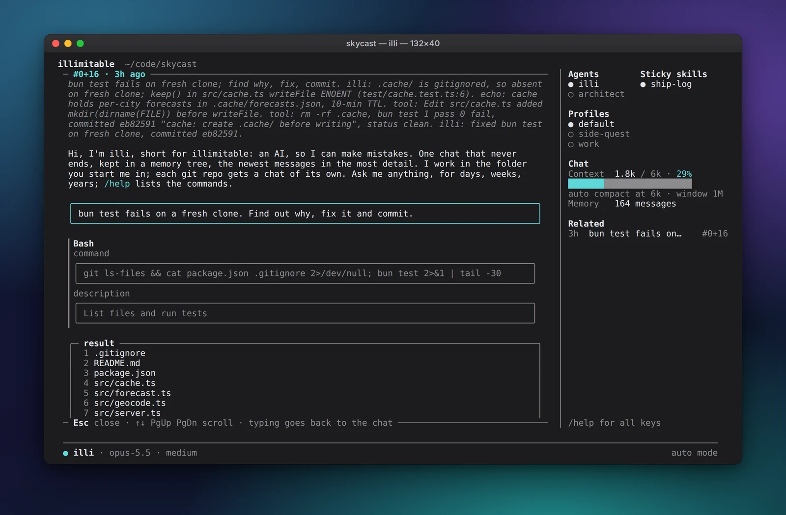
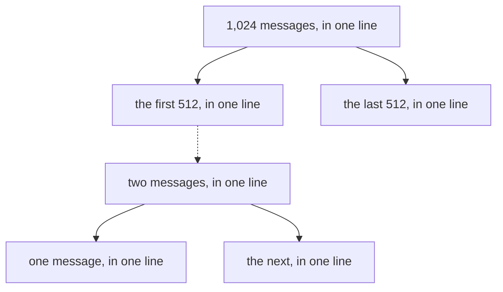
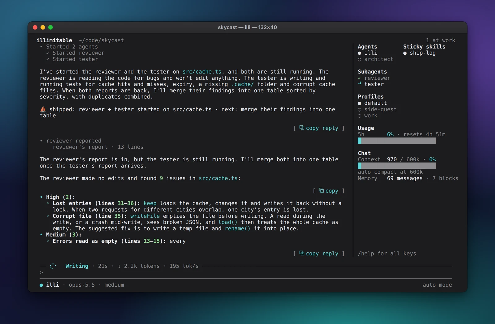
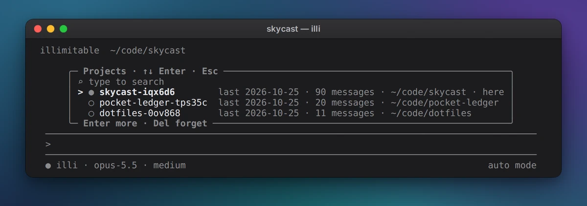
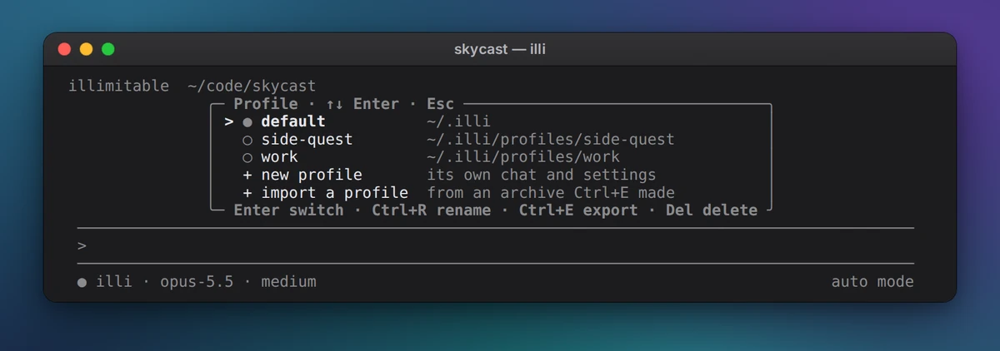

<p align="center">
  <b>One chat. It never ends, and it never forgets.</b><br>
  A terminal AI agent that keeps every word you've ever said to it,<br>
  folded into a memory tree it can unfold again.
</p>

<p align="center">
  <a href="#install">Install</a> ·
  <a href="docs/keys.md">Keys</a> ·
  <a href="docs/providers.md">Providers</a> ·
  <a href="docs/customize.md">Customize</a> ·
  <a href="docs/config.md">Config</a>
</p>



Install
-------

```bash
curl -fsSL https://raw.githubusercontent.com/4our4ace/illimitable-chat/main/install.sh | bash
```

Then type `illi` in any project. Linux and macOS (on Windows, WSL).
Once you trust the folder, it gets to work on its own, and asks before
it touches your secrets or the system, or changes a file outside the
project ([Permissions](docs/permissions.md)). It keeps itself up to date.

It remembers
------------

Most agents wake up with amnesia: every session starts empty, and a
full one is squashed into a summary, its details gone. illi has no
sessions.

Every message is kept, for weeks, months, years, and saved before illi
answers, so not even a crash loses one. Old messages fold into a tree
of summary lines, coarser with age, and any line unfolds back to the
exact words. While illi works, past moments that touch the same files
and errors light up at the side, a click away, and the strongest one
reaches illi itself, so it remembers before you ask.





The tree only ever grows at its end, so nearly every call is a prompt
cache hit: a chat a year long stays fast and cheap.

It works in parallel
--------------------

Send a reviewer and a tester off together. They work side by side,
report back, and illi merges what they found.



Every project, every you
------------------------

Each git repo gets a chat of its own, picked by the folder you start
in. Profiles keep work and home apart, and one you leave keeps running
in the background.

<p>
  
  
</p>

Rules that stick
----------------

A sticky skill is on for every reply, and no summary ever drops it.
Drop this in `~/.illi/skills/ship-log/SKILL.md`, type `/ship-log`, and
every answer ends with a ship log (the ⛵ line in the screenshots above):

```markdown
---
name: ship-log
description: Ends every reply with a one-line ship log
sticky: true
---
End every reply with one line:
⛵ shipped: <what changed> · next: <the next step>
```

Agents, commands, skills, MCP servers and hooks work in Claude Code's
formats, its plugins copy in as they are, and plugins of your own can
run TypeScript inside illi ([Customize](docs/customize.md)).

Your plan or your keys
----------------------

Your ChatGPT plan (`/login`), your Claude plan through your own
[Claude Code](https://code.claude.com), or Anthropic and OpenAI API
keys. The side shows how much of your plan is used
([Providers](docs/providers.md)).

The keys you need
-----------------

| Key                 | Does                                              |
| ------------------- | ------------------------------------------------- |
| Enter / Esc twice   | send / stop                                       |
| `/`                 | commands                                          |
| Ctrl+P              | every command and setting, searchable             |
| Shift+Tab           | switch agent                                      |
| Ctrl+O              | open every tool call                              |
| Tab                 | take the suggested reply                          |
| Ctrl+D              | on an empty input, quit (the next start resumes)  |

Everything else: `/help` and [Keys](docs/keys.md).

Docs
----

[Keys](docs/keys.md) ·
[Providers](docs/providers.md) ·
[Customize](docs/customize.md) ·
[Permissions](docs/permissions.md) ·
[Profiles](docs/profiles.md) ·
[Config](docs/config.md) ·
[Design](docs/design.md) ·
[Development](docs/development.md) ·
[Planned](docs/planned.md)

License
-------

Apache 2.0: LICENSE and NOTICE. Third-party notices are in
THIRD_PARTY_NOTICES.md.
