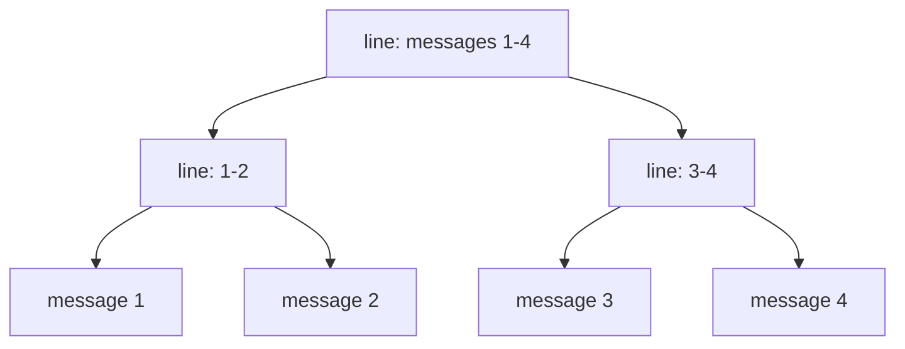

A terminal AI agent with one chat that never ends. illi (short for
illimitable) folds old messages into a memory tree it can zoom back
into, so it forgets nothing.

Written mostly by AI agents: expect bugs. illi runs shell commands and
edits files without asking, so use it where you'd let it.

Why illi
--------

Most coding agents work in sessions: each starts empty, and once it fills
up it is squashed into a summary and the details are gone. illi has no
sessions.

- **One chat, forever.** Every message stays on disk, for days, weeks,
  years. You never start over or explain things again.
- **Nothing is forgotten.** Old messages fold into a tree of summary
  lines, coarser with age, and illi can zoom any line back down to the
  exact words.
- **Built for the prompt cache.** The memory only changes at its end, so
  nearly every call is a cache hit: a long chat stays fast and cheap.
- **Your ChatGPT plan, or your keys.** ChatGPT Plus or Pro, or Anthropic
  and OpenAI API keys, all in illi's own loop: no SDKs, no dependencies.
- **Crash-proof.** A message is on disk before illi answers. Quit or
  crash mid-turn, and the next start goes on where it was.

Install
-------

    curl -fsSL https://raw.githubusercontent.com/4our4ace/illimitable-chat/main/install.sh | bash

Then run `illi` in any project folder. `illi upgrade` updates it. Linux
and macOS; on Windows, use WSL. The installer checks the release against
its SHA256SUMS; with no release for your system (or `ILLI_SOURCE=1`) it
builds from the source.

From source, with [Bun](https://bun.sh):

    git clone https://github.com/4our4ace/illimitable-chat
    bun illimitable-chat/src/main.ts

Sign in
-------

In the chat, type `/login` to sign in with your ChatGPT plan (Plus or
Pro): illi shows a code to enter on OpenAI's page, then keeps and renews
the login itself. An existing [opencode](https://opencode.ai) login is
picked up as it is.

Or use API keys: set `ANTHROPIC_API_KEY` or `OPENAI_API_KEY`, and name
the vendor in `~/.illi/config.json`:

    { "vendors": "claude-api" }

illi's pick and the summaries' then default to that vendor's models:
`claude-api` runs sonnet-5.5 and haiku-5.5, `openai-api` gpt-6.1-sol and
gpt-6-luna. To choose them, or list more vendors (the first gives the
defaults):

    {
      "vendors": "claude-api,chatgpt",
      "pick": "claude-api:opus-5.5:high:slow",
      "compactor": "claude-api:haiku-5.5:medium:slow"
    }

`ILLI_VENDORS=claude-api illi` tries it without a file; `/set vendors
claude-api` in the chat works from the next start.

How it works
------------



- **Memory tree.** Each message is summarized into one line, and lines
  merge in pairs into a binary tree, written in the background by a
  smaller model. A turn sends the latest messages whole, up to
  `context`; older ones go as lines, merged as they age. A turn that
  outgrows the model's window anyway goes on by itself, more of it
  summarized.
- **Zoom.** illi can open any line back down to the original messages.
  `/compact` folds all but the last two exchanges, so turns get smaller
  (the screen keeps showing them); `/clear` empties the screen for a
  fresh topic, and illi still remembers it all. `/tree` writes yours
  as a web page into the current folder.
- **Tools.** Shell, file edits, subagents, a to-do list, MCP servers.
  `/goal <message>` keeps it working until the goal is met.
- **Drawn replies.** Mermaid diagrams, highlighted code and boxed tables,
  the way [cellsmith](https://github.com/4our4ace/cellsmith) draws them
  in Claude Code.

Keys and commands
-----------------

| Key or command       | Does                                  |
| -------------------- | ------------------------------------- |
| Enter / Esc          | send / interrupt                      |
| Tab                  | take the suggested reply              |
| `/`                  | command list                          |
| Shift+Tab            | switch primary agent                  |
| `/login`             | sign in with your ChatGPT plan        |
| `/model`             | pick the model, its effort and speed  |
| `/settings`          | change any setting below              |
| `/profile`           | switch, make or export a profile      |
| `/tree`, `/export`   | the memory as a page, as JSON, written into the current folder |
| Ctrl+O               | show tool calls and thinking          |
| Drag, double-click   | copy text                             |
| Ctrl+Y               | copy the last reply                   |
| Alt+V                | paste an image                        |
| PgUp/PgDn, Ctrl+End  | scroll, jump to the bottom            |
| Ctrl+D               | quit (the next start resumes)         |

`/help` lists everything. From a pipe, each line is a message:
`echo "what changed?" | illi`.

Customize
---------

All in `~/.illi/`. A project's `.illi/` may hold agents, commands and
skills too, which win by name; the rest is read only from yours.
[`examples/`](https://github.com/4our4ace/illimitable-chat/tree/main/examples)
has samples. Or ask illi: it comes with a skill, `customize-illi`, and
writes these files itself.

- `agents/*.md`: agents. `mode: primary` ones are switched to with
  Shift+Tab; `subagent` ones are spawned by illi; `all`, the default,
  both. Each gets a color of its own; `color: "#rrggbb"` picks one.
- `commands/*.md`: `/name` sends the file, `$ARGUMENTS` filled in.
- `skills/<name>/SKILL.md`: skills, in Claude Code's format.
- `mcp.json`: MCP servers, in Claude Code's `mcpServers` shape (below).
  Only yours is read, never a project's.
- `theme.json`: colors and palette (`"palette": "nord"`, `mono`, `auto`).
- `RULES.md`: your rules for every project, in every prompt. illi writes
  it when you ask ("add that to my rules"), never on its own. A
  project's own `AGENTS.md` (else `CLAUDE.md`) is read too, from the
  repo's top down to the folder you start in.

An agent:

    ---
    description: Reviews a change for bugs; never edits
    mode: subagent
    model: gpt-6.1-sol
    effort: high
    tools: zoom, shell, read
    color: "#e0af68"
    ---
    You review code changes. ...

An `mcp.json`:

```json
{ "mcpServers": {
    "github": { "command": "npx", "args": ["-y", "@modelcontextprotocol/server-github"],
                "env": { "GITHUB_PERSONAL_ACCESS_TOKEN": "${GITHUB_TOKEN}" } },
    "docs":   { "type": "http", "url": "https://example.com/mcp",
                "headers": { "Authorization": "Bearer ${DOCS_TOKEN}" } } } }
```

Secrets go in as `${VAR}`, read from the environment, never in the file.

Profiles
--------

Separate chats and settings, e.g. work and home, each in its own folder:
the default in `~/.illi`, the others in `~/.illi/profiles/<name>`.
`/profile` opens the list (the side panel shows them too), and all of it
happens there: Enter switches, Ctrl+R renames, Ctrl+E exports to
`./illi-profile-<name>.tar.gz`, Del deletes. "+ new profile" asks a name,
then what comes along: nothing, this profile's setup, this chat (moved,
so this profile starts fresh), or both. "+ import a profile" asks for an
archive. `/profile work` switches straight away. Profiles share the
login, the API keys and the default's config.json. illi's memory is the
running profile's chat alone: its read, write and edit tools refuse every
chat folder, and its prompt keeps the shell out of other profiles' too.

- An export leaves out the login (and a login file its config names
  inside the profile's folder), the lock and the log.
- It strips config.json and mcp.json of secrets: by key name, or shaped
  like a known key or token.
- The rest goes as it is: the chat, agents, commands, skills, theme.json
  and RULES.md.
- An import is treated as untrusted: its config's `after`, `rules`,
  `login`, `mcp` and `theme` are dropped and its MCP servers turned off.
- Its agents, commands, skills, RULES.md and chat come in as they are, at
  work once you switch to it.

Config
------

`~/.illi/config.json`, or `ILLI_<KEY>` variables. All optional.

- `/settings` changes them from inside illi (`/set <key> <value>` too).
- Most apply at once; `vendors`, `models`, `jobs`, `theme`, `mcp` and
  `login` at the next start.
- A key set by a variable stays as the variable says.
- A relative path is taken from the folder of the config.json that names
  it (a variable's: the working folder).
- A value that won't do stops illi at the start, saying which. A pick
  no longer offered gives way to its default, with a note.

| Key          | Default                           | What                                             |
| ------------ | --------------------------------- | ------------------------------------------------ |
| `vendors`    | `chatgpt`                         | also `claude-api`, `openai-api` (API keys)       |
| `pick`       | `chatgpt:gpt-6.1-sol:medium:slow` | vendor:model:effort:speed (`/model` per chat); default: the first vendor's |
| `compactor`  | `chatgpt:gpt-6-luna:medium:slow`  | writes the summaries; default: the first vendor's |
| `agents`     | the pick                          | what subagents run on                            |
| `models`     | all                               | models offered                                   |
| `context`    | `auto`                            | tokens a turn sends: `auto` (70% of the window, at most 400k), a number, or `"60%"` |
| `contexts`   |                                   | per model: `{ "gpt-6.1-sol": 350000 }`           |
| `rules`      | `RULES.md` in the profile's folder | your rules for every project (none: no rules)   |
| `after`      |                                   | a shell command run after each turn              |
| `side`       | `right`                           | side panel: `left`, `off`; `side_width` `25%`    |
| `suggest`    | `on`                              | a suggested reply after each turn; `off`         |
| `jobs`       | `8`                               | summaries built at once                          |
| `theme`, `mcp` | the profile's folder            | the theme's and the MCP servers' files           |
| `login`      | `~/.illi/login.json`, opencode's  | the ChatGPT login file, which `/login` writes    |

API keys come from `ANTHROPIC_API_KEY` and `OPENAI_API_KEY`. The chat is
in `~/.illi/chat`, every message kept; days over a month old are gzipped.
Back it up.

Troubleshooting
---------------

- Something went wrong: illi logs it in its profile's folder,
  `~/.illi/illi.log` (another profile's: `~/.illi/profiles/<name>/illi.log`).
- "illi is already open in another terminal": a profile's chat runs in
  one illi at a time. Quit it there (Ctrl+D), or start another profile:
  `ILLI_PROFILE=<name> illi`.

Code
----

    src/main.ts    the illi command
    src/term/      the terminal app: keys, selection, commands, side panel
    src/ui/        the chat's view, markdown, replies, diagrams, the screen
    src/chat/      the chat, its memory tree (Memory.ts), the disk
    src/ai/        model vendors, the agent loop, picks, token usage
    src/tools/     shell and files, MCP servers, the prompts
    src/config/    settings, profiles, your agents, commands and skills
    test/          tests across modules; each module's own sit beside it
    vendor/        cellsmith's markdown parser and diagram engine

Each file starts with a comment on its design. `bun run test` runs the
tests, `bun run check` the type check (after `bun install`).

License
-------

Apache 2.0: LICENSE and NOTICE. `vendor/cellsmith/` and the libraries it
bundles are MIT, licenses inside.

Roadmap
-------

Planned, roughly in this order. Until then, illi runs what it decides
to, as you: use it where you'd let it.

- **Permissions.** Rules for what illi may run or change without asking
  (allow, ask, deny), and a prompt for the rest: once, always in this
  project, always, or no with a reason illi reads. Secrets such as
  `~/.ssh` hidden, `.git` and shell rc files protected, the mode on the
  bottom line, and subagents' requests in the same queue, named.
- **Sandbox.** Shell commands in a bubblewrap sandbox: only the project
  and `/tmp` writable, secrets hidden, network off. illi asks before
  anything leaves it, so work inside it needs no prompts.
- **Project trust.** A project's own `.illi` agents, commands and skills
  load only once you trust the folder.
- **An AI reviewer.** Optionally, a small model approves routine requests
  to leave the sandbox, so you're asked less.
