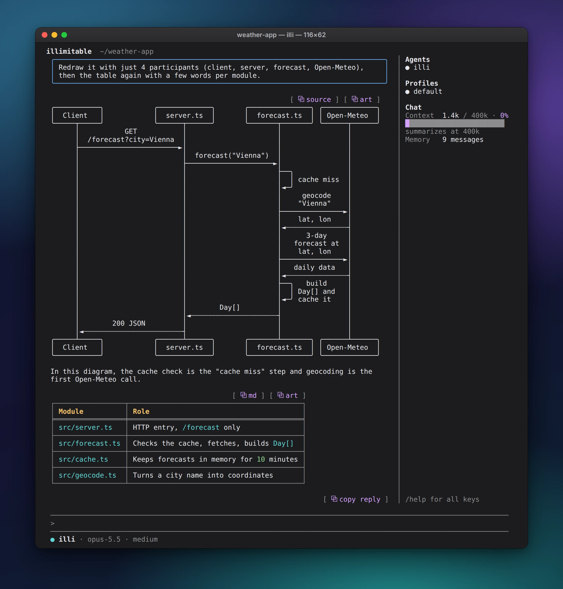
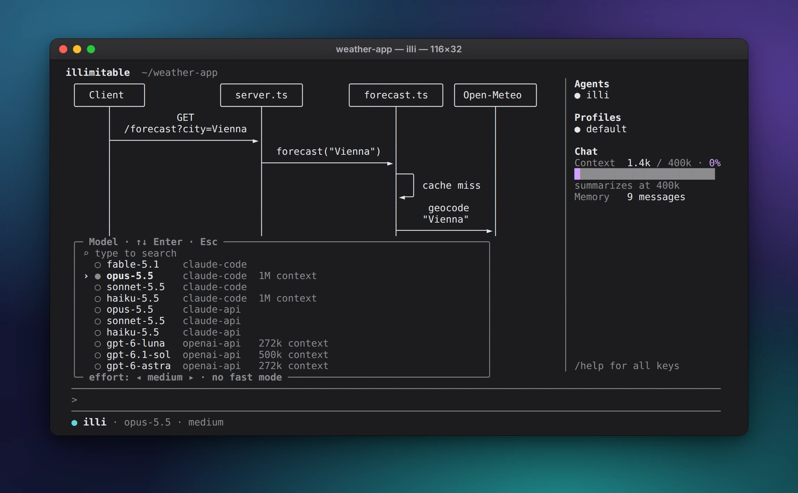
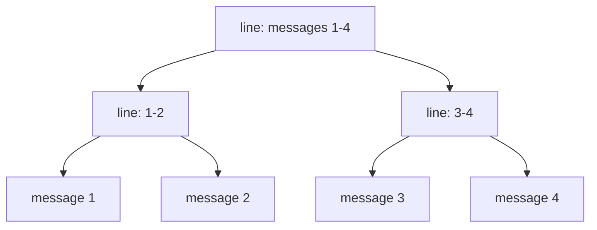
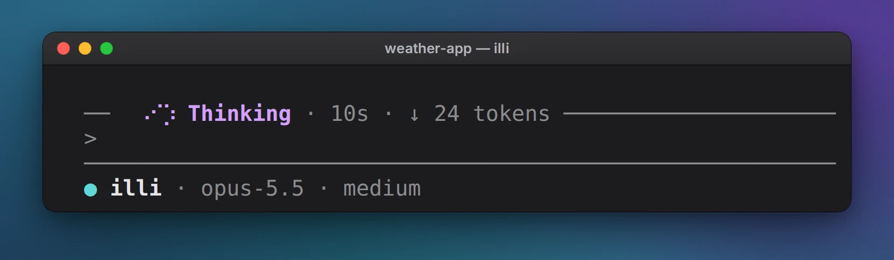

A terminal AI agent with one chat that never ends. illi (short for
illimitable) folds old messages into a memory tree it can zoom back
into, so it forgets nothing.

Why illi
--------

Most coding agents work in sessions: each starts empty, and once it fills
up it is squashed into a summary and the details are gone. illi has no
sessions.

- **One chat, forever.** Every message stays on disk, for days, weeks,
  years. You never start over or explain things again.
- **A chat per project.** Each git repo gets its own chat, picked by the
  folder you start illi in; outside any repo, a home chat. illi looks
  into your other projects when you mention them, and `/projects` lists
  them, to forget one for good. Start illi in a second terminal in the
  same project and it joins the running chat: both screens show it, and
  either one can type.
- **Nothing is forgotten.** Old messages fold into a tree of summary
  lines, coarser with age, and illi can zoom any line back down to the
  exact words.
- **Built for the prompt cache.** The memory only changes at its end, so
  nearly every call is a cache hit: a long chat stays fast and cheap.
- **Your plan, or your keys.** ChatGPT Plus or Pro, or Anthropic and
  OpenAI API keys, in illi's own loop with no SDKs; or your Claude plan,
  through your own Claude Code.
- **Crash-proof.** A message is on disk before illi answers. Quit or
  crash mid-turn, and the next start goes on where it was.
- **Yours to change.** Agents, commands, skills, MCP servers, shell
  hooks and a status line in Claude Code's formats, its plugins as they
  are, and plugins of your own in TypeScript
  ([Customize](docs/customize.md)).

Install
-------

    curl -fsSL https://raw.githubusercontent.com/4our4ace/illimitable-chat/main/install.sh | bash

Then run `illi` in any project folder. The first time in a folder, it
asks, full screen, whether you trust it: illi reads, edits and runs
files there and follows its `AGENTS.md` or `CLAUDE.md`. A yes is kept
for the whole repo; your home folder is asked at every start. Then
illi runs routine work and asks before a risky call, saying why
([Permissions](docs/permissions.md)). It goes
in `~/.local/bin` (or
`ILLI_INSTALL`) and updates itself: once a day, as it starts or while
it runs, it looks for a new release, downloads and checks it in the
background, and runs it from the next start (`autoupdate` in [Config](docs/config.md) makes
it only tell, or never look). `illi upgrade` updates it now, `illi
version` says which it is. Linux and macOS; on Windows, use WSL. Each
release is checked against its SHA256SUMS; with no release for your
system (or `ILLI_SOURCE=1`) the installer builds from the source.

From source, with [Bun](https://bun.sh): see
[Development](docs/development.md).

Sign in
-------

In the chat, type `/login` to sign in with your ChatGPT plan (Plus or
Pro). Your Claude plan (Pro or Max) works through your own
[Claude Code](https://code.claude.com), and Anthropic and OpenAI API
keys work too: see [Providers](docs/providers.md).

How it works
------------

- **Memory tree.** Each message is summarized into one line, and lines
  merge in pairs into a binary tree, written in the background by a
  smaller model. A turn sends the latest messages whole, up to
  `context`; older ones go as lines, merged as they age. A turn that
  outgrows the model's window anyway goes on by itself, more of it
  summarized.
- **Zoom.** illi can open any line back down to the original messages.
  `/compact` has illi write a recap of the chat and go on from it
  alone, as other agents compact (the screen keeps the chat, a
  "Compaction" line across it); `/clear` starts a fresh topic. Either
  way the chat before isn't sent at all, yet stays kept and
  summarized, so illi finds any of it by search or zoom. `/tree`
  writes yours as a web page into the current folder.
- **Tools.** Shell, file edits, subagents, a to-do list, MCP servers,
  questions with options you pick in the input, your answers kept in
  the chat.
  `/goal <message>` keeps it working until the goal is met.
- **Drawn replies.** Mermaid diagrams, highlighted code and boxed tables,
  the way [cellsmith](https://github.com/4our4ace/cellsmith) draws them
  in Claude Code.

Two subagents at work side by side, then illi merging what they found:

Keys and commands
-----------------

| Key or command       | Does                                  |
| -------------------- | ------------------------------------- |
| Enter / Esc twice    | send / interrupt                      |
| Tab                  | take the suggested reply              |
| `/`                  | command list                          |
| Ctrl+P               | every command and setting, searchable |
| Ctrl+X, then a key   | a shortcut (m model, s settings…); `/shortcuts` changes them |
| Shift+Tab            | switch primary agent                  |
| `/login`             | sign in with your ChatGPT plan        |
| `/model`             | pick the model, its effort and speed  |
| `/settings`          | change any setting                    |
| `/profile`           | switch, make or export a profile      |
| `/tree`, `/export`   | the memory as a page, as JSON, written into the current folder |
| Ctrl+O               | show tool calls and thinking          |
| Drag, double-click   | copy text                             |
| Right drag           | quote the text in your message        |
| Ctrl+Y               | copy the last reply                   |
| Alt+V                | paste an image                        |
| PgUp/PgDn, Ctrl+End  | scroll, jump to the bottom            |
| Ctrl+D               | quit (the next start resumes)         |

`/help` lists everything, as does [docs/keys.md](docs/keys.md). From a
pipe, each line is a message: `echo "what changed?" | illi`.

Docs
----

- [Keys](docs/keys.md): every key and command, the mouse, the side panel.
- [Providers](docs/providers.md): ChatGPT, your Claude plan through
  Claude Code, API keys, and which models do what.
- [Customize](docs/customize.md): agents, commands, skills, MCP servers,
  plugins, hooks, a status line, the theme and its accent, rules.
- [Permissions](docs/permissions.md): what runs without asking, the
  modes, the question, your rules.
- [Profiles](docs/profiles.md): separate chats on one global setup, e.g.
  work and home.
- [Config](docs/config.md): every setting and variable, the files illi
  keeps, troubleshooting.
- [Development](docs/development.md) and what is [Planned](docs/planned.md).

License
-------

Apache 2.0: LICENSE and NOTICE. `vendor/cellsmith/` and the libraries
compiled in are MIT: their licenses are in `vendor/cellsmith/` and
THIRD_PARTY_NOTICES.md.
