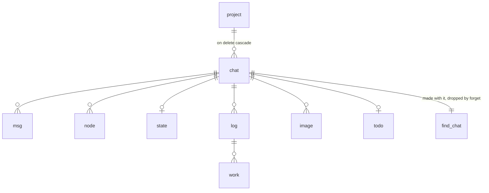
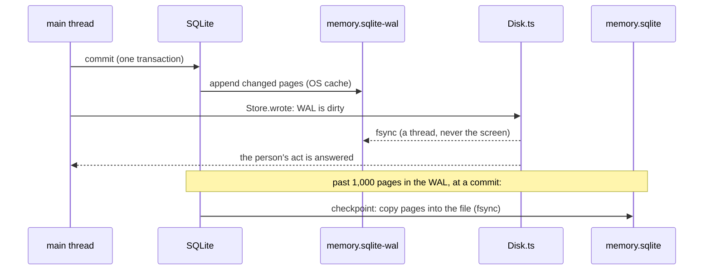
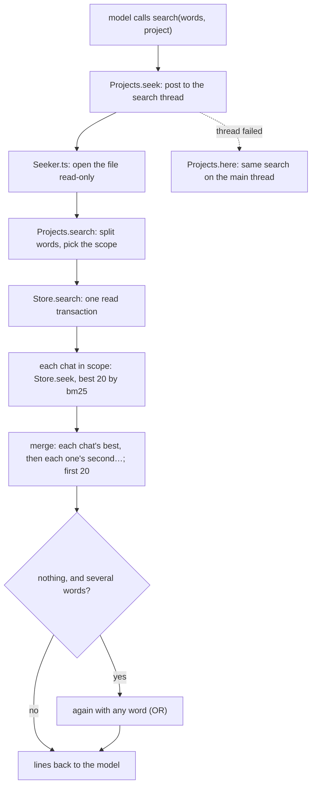

The chat file
=============

Everything illi remembers lives in one SQLite file per profile. This page
covers exactly how that file is laid out, who opens it, how a write
reaches the disk, how the version upgrades work, how search and
forgetting work, and what each costs. Each part names the function that
does the work. If this page and the code disagree, the code is right and
this page needs fixing.

- [Where it is](#where-it-is)
- [What is in it](#what-is-in-it)
- [The file's settings](#the-files-settings)
- [Who opens it](#who-opens-it)
- [Opening, step by step](#opening-step-by-step)
- [Versions and upgrades](#versions-and-upgrades)
- [Writing and durability](#writing-and-durability)
- [Project locks](#project-locks)
- [The projects table](#the-projects-table)
- [Search](#search)
- [Forgetting a project](#forgetting-a-project)
- [Usage counts](#usage-counts)
- [Known limits](#known-limits)

Where it is
-----------

| Profile         | File                                          |
| --------------- | --------------------------------------------- |
| default         | `~/.illi/chat/memory.sqlite`                  |
| any other       | `~/.illi/profiles/<name>/chat/memory.sqlite`  |

`ILLI_DIR` moves `~/.illi`. While the file is open, SQLite keeps two more
files beside it: `memory.sqlite-wal` (new writes, see
[Writing](#writing-and-durability)) and `memory.sqlite-shm` (an index into
the WAL that the open connections share). When the last connection closes
cleanly, SQLite copies the WAL into the file and deletes both, so only
`memory.sqlite` is left.

One file holds every project of its profile: one project for each git
repo illi ran in, plus `home` for everywhere outside a repo
(`Projects.place`).

What is in it
-------------

### Tables

The schema is created by `STEPS` in `src/chat/Store.ts`.

| Table      | One row is                                      | Key                     | Written                        |
| ---------- | ----------------------------------------------- | ----------------------- | ------------------------------ |
| `meta`     | a fact about the file (today only `compat`)     | `key`                   | by upgrades                    |
| `project`  | a place illi ran in                             | `id`                    | once, at the first run there   |
| `chat`     | a project's chat (one per project today)        | `id`                    | once, with its project         |
| `msg`      | a message, or one page of a long message        | `(chat, i)`             | once; never changed            |
| `node`     | a summary line over a run of messages           | `(chat, first, n)`      | once; never changed            |
| `state`    | a chat's saved view, pick, goal, cut…           | `chat`                  | written over                   |
| `log`      | an agent's log (a subagent's name and tag)      | `id`, unique `(chat, log)` | once                        |
| `work`     | one entry of an agent's log                     | `(log, i)`              | once; never changed            |
| `image`    | an image a message names (its bytes, its smaller copy for models) | `id`, unique `(chat, name)` | once (the name is its hash) |
| `todo`     | a chat's to-do list, whole                      | `chat`                  | written over                   |
| `find_<chat>` | one chat's search index (FTS5)               | `rowid`                 | one row with each new `node`   |

The columns, by table:

- **project**: `id` (autoincrement: a number is never used again, even
  after a forget), `uid` (a random UUID, so two files could be merged one
  day), `key` (`git:<repo's top folder>` or `home`), `name` (the folder's
  name plus a 6-character code from its path, such as `app-k3f9x2`;
  unique), `path` (`""` for home), `made` (ISO date), `extra` (a JSON
  object, `{}`, for later use).
- **chat**: `id`, `uid`, `project` (references `project`, on delete
  cascade), `made`, `extra`.
- **msg**: `chat`, `i` (its index in the chat: 0, 1, 2…), `kind` (`user`,
  `illi`, `tool`…), `text`, `date`, `size` (bytes as models read it),
  `images` (a JSON list of image names, or null), `line` (its summary line
  if it was written with one), `more` (1 if the next row is the same
  message continued), `cwd` (the folder illi ran in). A message longer
  than 30,000 characters (`Clip.ts CAP`), or with more than 20 images
  (`Memory.ts PICS`), is stored as several rows, its pages. Only the last
  page has `more` null. A partial index `msg_page` on `(chat) where more
  is not null` lists the continued pages, so a chat's count of whole
  messages costs nothing.
- **node**: `chat`, `first`, `n`, `text`. A line covers messages
  `first … first + n - 1`. The memory tree (`Memory.ts`) is binary: node
  (level `l`, index `i`) has `first = i · 2^l` and `n = 2^l`. The table
  doesn't depend on that shape: any `(first, n)` fits. A line built twice
  keeps the first one (`on conflict do nothing`), because a view may
  already show it. The index `node_end` on `(chat, first + n)` finds a
  chat's latest line at once.
- **state**: `chat`, `saved` (JSON: the chat's view, `seen` (the
  compactions' view), the pick, the goal, the main agent, what ran, the
  cut, `show` and `top`). It is never rebuilt from the facts,
  because the model's prompt cache depends on the saved view.
- **log**: `id`, `chat`, `log`, `name`. **work**: `log` (references
  `log`), `i`, `kind`, `text`, `date`.
- **image**: `id`, `chat`, `name` (its hash, so an image pasted twice is
  kept once), `data` (bytes), `fit` (a smaller copy for models, or null).
- **todo**: `chat`, `list` (JSON).
- **find_\<chat\>**: an FTS5 table with `text` (the line), `first` and `n`
  (stored but not indexed). Its tokenizer is `unicode61 remove_diacritics
  2`; see [Search](#search). FTS5 keeps each index in five more real
  tables, `find_<chat>_data`, `_idx`, `_content`, `_docsize` and
  `_config`, so each chat adds six entries to the schema.



### The rules the tables follow

1. **Facts are added, never changed.** `msg`, `node`, `work` and `image`
   rows are only inserted. Only `state` and `todo` are written over.
2. **Only forgetting deletes.** `Store.forget` deletes a project's row,
   and the foreign keys delete everything below it. No other code
   deletes a message, a line or an image.
3. **A search index loses lines only by being dropped whole.** No line
   is ever deleted from a `find_<chat>` alone. So a chat's line count is
   its highest `rowid`, which [search](#search) relies on.

The file's settings
-------------------

| Setting (pragma)  | Value                     | Kept in             | Why |
| ----------------- | ------------------------- | ------------------- | --- |
| `application_id`  | `0x696c6c69` ("illi")     | the file            | marks the file as illi's |
| `user_version`    | `3`                       | the file            | the schema's version ([upgrades](#versions-and-upgrades)) |
| `journal_mode`    | `wal`                     | the file            | readers and the writer don't block each other |
| `auto_vacuum`     | `incremental` (2)         | the file            | space can be given back; nothing moves until illi asks |
| `synchronous`     | `normal`                  | each connection     | a commit doesn't wait for the disk; Disk.ts flushes |
| `secure_delete`   | `on`                      | each connection     | deleted content is overwritten with zeros |
| `foreign_keys`    | `on`                      | each connection     | deleting a project deletes everything below it |
| `busy_timeout`    | `10000` ms                | each connection     | wait for another process's write instead of failing |

Defaults left as SQLite ships them: a page is 4,096 bytes, and
`wal_autocheckpoint` is 1,000 pages (about 4 MB).

`auto_vacuum` can only be switched on in an empty file, before it is put
in WAL mode, which is why `Store.schema` sets it first on a new file. A
file illi made always has it.

Who opens it
------------

Several processes and threads can have the file open at once. SQLite
allows any number of readers and one writer at a time. A writer that
finds another writing waits up to `busy_timeout` (10 s) and then fails.

| Who | Connection | When | Code |
| --- | --- | --- | --- |
| **The holder**: the illi that holds a project's lock and runs its chat | read-write, kept open until illi quits | always, one per project being used | `Memory.load` → `Store.open(dir, place)` |
| **Other holders**: illis running in other projects of the same profile | read-write, one each | when you use several repos at once | the same |
| **A view**: a second terminal in the same project | read-write | to read exports, the tree and the projects list; the chat itself comes from the holder over a socket | `Term.ts term_reader` |
| **The search thread** (`Seeker.ts`) | read-only, opened per search, closed after | each `search` the model calls | `Projects.seek` |
| **Upkeep**: forgetting the project you're in | read-write, opened with no project | once, between closing the chat and illi starting again | `ProjectCommands.ts project_forget` |

Each write is small (0.16 ms measured on a 2-million-message file), so
another process rarely waits long.

Opening, step by step
---------------------

`Store.open(dir, place)` does this, in order:

1. Creates the folder, then opens or creates `memory.sqlite`.
2. Sets `busy_timeout = 10000` and `foreign_keys = on`.
3. `Store.schema`: brings the schema up to date
   ([below](#versions-and-upgrades)). On a brand-new, empty file it first
   sets `auto_vacuum = incremental`.
4. `Store.wal`: sets `journal_mode = wal`. Switching ignores
   `busy_timeout`, so it is retried every 10 ms for up to 10 s while
   another illi opening the file at the same moment holds it.
5. If `auto_vacuum` reads `1` (full), sets it back to `incremental`. Only
   a forget cut off between its two `auto_vacuum` pragmas can leave it at
   `full` ([Forgetting](#forgetting-a-project), step 4).
6. Sets `synchronous = normal` and `secure_delete = on`.
7. `Store.place` (skipped for upkeep): finds the project by its `key`,
   or creates it (if its name is taken, it adds `-2`, `-3`…), then its
   first chat, which it creates with an empty `find_<chat>` if new. This
   all runs in one write transaction.

Versions and upgrades
---------------------

### What "the format" means

The file's format is its schema: which tables exist and what they hold.
`user_version` says how many of the `STEPS` in `Store.ts` the file has
been through. Every illi knows its own number (`STEPS.length`, now 3).

| Step | Brings the file to | What it does | Sets `compat` |
| ---- | ------------------ | ------------ | ------------- |
| 1    | version 1 | creates everything: `meta`, `project`, `chat`, `msg`, `node`, `state`, `log`, `work`, and one shared search index `find` for every chat | 1 |
| 2    | version 2 | adds `image` and `todo` (images and the to-do list used to be separate files) | 2 |
| 3    | version 3 | gives each chat its own search index `find_<chat>`, copies every line into it from `find` in its original order, then drops `find` | 3 |

### When an upgrade runs

At every open, `Store.schema` compares the file's `user_version` with its
own `STEPS.length`:

- **The file is older:** each missing step runs in its own write
  transaction (`begin immediate`), which also sets the new
  `user_version`. Inside the transaction it checks the version again,
  because another illi may have just run the same step. A crash
  mid-step rolls the step back whole, and it runs again at the next open.
  Steps run after `secure_delete` is on (what a step deletes is zeroed)
  but before `synchronous = normal`, so at SQLite's default `full`: each
  step's commit waits for the disk. A new file's first step even runs
  before WAL mode, in SQLite's rollback journal; an older file is in WAL
  mode already (the mode is kept in the file).
- **The file is the same:** nothing happens.
- **The file is newer:** illi reads `meta.compat`. If compat is at most
  its own number, the newer illi only *added* things, and this illi
  opens the file as it is. If compat is higher, illi stops with: *the
  chat (memory.sqlite) is of a newer illi: update illi to open it*.

`compat` is the lowest version that can still use the file safely. A
step that only adds (a table, an index, a column with a default) leaves
it alone, so an older illi keeps working. A step that moves where facts
live raises it, because an older illi would look for them in the old
place.

### Step 3 in detail

1. It reads the ids of all chats.
2. It creates an empty `find_<chat>` for each (`Store.words`).
3. It reads every row of the old `find`, oldest first (rowid order), and
   inserts it into its chat's new table. Rows of a chat that no longer
   exists are skipped.
4. It drops `find` (its pages are zeroed by `secure_delete`) and sets
   `compat` to 3.

All of that is one transaction. It takes time linear in the number of
summary lines: about 13.6 s and a 294 MB WAL peak for 400,000 lines,
and milliseconds for files of a few MB. While it runs, another illi
opening the file waits up to 10 s, then fails to start; starting it
again works.

An illi from before step 3 that is *still running* when another illi
upgrades the file keeps logging messages (`msg` didn't change). Its next
summary-line write fails whole, because it writes `node` and `find` in
one transaction and `find` is gone, so nothing is half-written. At its
next start it refuses the file because of `compat`, and it needs
updating.

### Rules for later steps

- A step only adds, or it raises `compat`.
- A table for a chat's rows references `chat (id) on delete cascade`, so
  even an older illi's forget deletes its rows.
- A table made for each chat (as `find_<chat>` is) has to be made by
  everything that makes a chat (`Store.place` calls `Store.words`). A
  step adding another such table must create it when a chat is first
  used, because an older illi may still be creating chats without it, or
  else raise `compat`.
- A step that moves a lot of data runs at the first open, before the
  screen shows. Later ones should move each chat's data when that chat
  is first used, so a big file never makes a start wait minutes.

Writing and durability
----------------------

### One write

Every write is one SQLite transaction (`Store.push`, `Store.nodes`,
`Store.save`…): a message's pages together, a batch of summary lines
with their index entries together. A transaction is all or nothing.



1. **Commit.** SQLite appends every page the transaction changed to the
   WAL. In `synchronous = normal` the commit does not wait for the disk:
   the pages are in the OS's cache, and the screen goes on.
2. **Flush (Disk.ts).** `Store.wrote` marks the WAL dirty. One flush
   runs at a time: it fsyncs every file marked since the last flush
   began, off the main thread (`FileHandle.sync`). Writes that arrive
   during a flush wait for the next one, so a burst of writes costs one
   or two fsyncs (group commit). A file gone since (`ENOENT`) needs none.
3. **Answer.** An act of the person's (a message sent, a pick, a
   setting) is answered only once the flush covering it is done. Quitting
   waits for it too (`Disk.synced` in `term_leave`).
4. **Checkpoint.** When the WAL passes 1,000 pages, the commit that
   crosses that mark also copies the WAL's pages into `memory.sqlite`.
   SQLite fsyncs the WAL before copying and the file after. The WAL is
   then reused from its start. A checkpoint can't copy pages that a
   reader's snapshot still needs, so a long search can delay it.
5. **Close.** The last connection to close checkpoints everything and
   deletes the WAL.

What this guarantees:

- **illi crashes, or is killed:** nothing is lost. The OS already holds
  every committed write.
- **The machine crashes, or loses power:** at most the writes since the
  last finished flush are lost, and an act that was answered is never
  lost. The file is never left half-written.
- **Disk wear:** each write is the few 4 KB pages it touches, written to
  the WAL and later once into the file.

Project locks
-------------

One process at a time holds a project's chat. The lock lives in
`~/.illi/locks/` (a folder only you can open, mode 0700):

| File | Is |
| ---- | -- |
| `<code>.lock` | the lock. `<code>` is a 12-character hash of the project's folder, or `home` (`Projects.lock`) |
| `<code>.sock` | the holder's socket (mode 0600), where a second terminal's view connects |

**Taking it** (`Chat.claim`, `Chat.grip`): illi opens the lock file as an
SQLite database, sets `busy_timeout = 50` ms (`GRIP`) and `journal_mode
= memory` (no journal file is left behind), and runs `begin exclusive`.
If that succeeds, the transaction stays open as long as the process
lives. The OS releases it however the process ends, so a crash never
leaves a stale lock.

**Why wait 50 ms:** without a wait, several illis starting at the same
moment each took a shared lock and then all failed to take it
exclusively, so nobody won. With a short wait, SQLite's deadlock
avoidance lets exactly one through. On a very busy machine the window
can be missed. Then every illi becomes a view, waits 15 s for a holder
that isn't there (`Remote.ts MUTE`), and runs again.

**If another illi holds it:** this one becomes a view of that chat
(`Remote.ts`), connected over the socket.

**Forgetting another project** takes that project's lock (without a
socket) for as long as the forget runs, so no illi can open that
project meanwhile. If an illi already has it open, illi refuses the
forget.

The projects table
------------------

`Store.projects` builds what `/projects` shows and what the model's
`projects` tool returns: each project's name, folder, first and last
message dates, message count, and latest summary line, the one used last
first.

For each chat it runs four small queries, all by index: the first
message, the last message, the count of continued pages (subtracted to
count whole messages), and the latest line. Two of them name their index
(`indexed by msg_page`, `indexed by node_end`). The file keeps no table
statistics, and without them SQLite's planner picked a full scan of the
chat's rows: 161 ms for one query on a 2-million-line chat, against
0.0 ms by index.

Search
------

The model's `search` tool finds summary lines by their words, in this
project, in another one by name, or in `all`. Every line ever written can
be found, however old: nothing is capped by age.



### The thread

`Projects.seek` sends each search to one worker thread
(`src/chat/Seeker.ts`), started at the first search and never keeping
illi from quitting (`ref: false`). For each search the worker:

1. opens `memory.sqlite` read-only, with `busy_timeout = 10000`;
2. runs `Projects.search`, the same code the main thread would run;
3. sends back the text, or the error;
4. closes the connection.

The main thread never waits: during a 2.9 s search on a 2-million-line
chat it kept drawing the screen (its longest gap was 14 ms). If the
worker can't start, or a message can't be posted, the search runs on the
main thread instead (`Projects.here`). If the worker dies, every search
still waiting on it runs on the main thread, and the next search starts
a new worker. In the compiled binary, the worker's code is a second
entry of the build (`src/chat/Seeker.ts` in `package.json`'s `build`,
`install.sh` and the release workflow), found at `./chat/Seeker.ts`.

### Projects.search

1. Splits the words on whitespace.
2. Picks the scope: `""` means this project; a name means that project
   (an unknown name answers *No project X: projects lists them.*);
   `all` means every project.
3. Calls `Store.search`, then writes each line as `project first+n|text`,
   its newlines flattened to spaces. With nothing found it says so,
   naming the scope.
4. In `all`, if lines were left out (step 5 of `Store.search` keeps 20),
   it adds a last line naming the projects they're in, the most first,
   with how many: *More lines in: app-k3f9x2 (12+), site-7q2m0d (3);
   search with project to see them.* A `+` means a chat of that project
   gave its most (20), so it may hold more still. The model can then
   search that project alone.

### Store.search

1. **Words to terms.** It keeps only words with at least one letter,
   digit or private-use character (Unicode `\p{L}`, `\p{N}`, `\p{Co}`).
   These are the characters the tokenizer indexes; a word like `—` would
   match nothing. With no term left, it returns nothing.
2. **One snapshot.** The rest runs inside one read transaction. The
   connection sees the file as it was at the first read and nothing
   committed later. So a forget that drops an index mid-search changes
   nothing for this search, and an `all` search sees every chat as of
   the same moment.
3. **Chats in scope.** It lists the chats of the projects in scope.
4. **Each chat** gives up to 20 lines from its own index (`Store.seek`),
   ranked by bm25.
5. **Merge.** Sorted by rank within its chat first, then by score: every
   chat's best line, best first; then every chat's second; and so on.
   The first 20 are kept; the rest are counted by project (`cut`), for
   the *More lines in* line above. A chat's bm25 scores weigh each word
   by how rare it is *in that chat*, so scores from a big chat and a
   small one can't be compared. Sorted by raw score, one big chat's
   matches would fill all 20 places and hide every small project's. With
   many projects, though, each gets only a line or two: 20 projects with
   matches give one line each.
6. **AND, then OR.** First a line must hold *all* the terms. If nothing
   matches and there was more than one term, it searches again for
   lines holding *any* of them.

### Store.seek: one chat

1. **Quoting.** Each term goes in double quotes (a `"` inside is
   doubled), so words like `AND`, `NOT`, `NEAR` or `ab*` are plain words,
   never FTS5 operators. Terms are joined by a space (AND) or by ` OR `.
2. **Tokenizing.** FTS5's `unicode61` tokenizer, with
   `remove_diacritics 2`, lowercases everything, strips accents
   (`café` matches `cafe`, `Über` matches `uber`), and splits on anything
   that isn't a letter or digit. A quoted word with punctuation becomes a
   phrase: `e-mail` matches the two tokens `e mail` side by side.
3. **The chat's size.** `lines` is the chat's highest rowid, its number
   of lines, since no line is ever deleted alone.
4. **Common words, in big chats only.** With more than `LARGE` (20,000)
   lines, each term is checked in three stretches of `SAMPLE` (1,000)
   lines: the newest, the middle and the oldest. Each check is one count
   query bounded by rowid. A term found in more than half the lines of
   *all three* stretches counts as common, and is left out of the query,
   as long as at least one term isn't common.
   - *Why it is safe:* FTS5's bm25 gives a word in more than half the
     lines a weight of almost nothing (its IDF is clamped to 0.000001),
     so leaving it out doesn't change the ranking.
   - *Why it matters:* matching such a word means reading its whole
     posting list, millions of entries in a big chat, which took
     seconds.
   - *The one effect:* with AND, a line no longer has to contain the
     common word. Searching `the sqlite` in a big chat finds the lines
     with `sqlite`.
   - *A word common only lately* (in the newest stretch but not the
     oldest) is kept, because it is still rare across the chat.
   - *If every term is common,* all are kept and the search reads them
     all. That is the slow case, and it runs in the worker.
5. **The query.** `select first, n, text, bm25(...) ... where ... match
   ? order by score limit 20`. A lower bm25 score is a better match.

### What search costs

Measured on a 2-million-message chat (8.6 GB, in RAM):

| Search | Time |
| ------ | ---- |
| a rare word | 0.4 ms |
| a word in 1 of 1,000 lines | 6 ms |
| a common word next to a rare one | 6.6 ms |
| a few common words | 245–454 ms |
| only the most common word (`the`) | 2.9 s, in the worker, the screen unaffected |

With 1,000 chats in one file (6,026 schema entries), opening the file
takes 50 ms and an `all` search 203 ms on a fresh connection (73 ms
warm). The worker opens a fresh connection for each search.

Forgetting a project
--------------------

### What you do

1. `/projects`, pick a project, press Delete.
2. Choose **Cancel** (lit at first), **Export a copy first, then
   forget**, or **Forget**. The export writes
   `./illi-project-<name>.json` in the current folder, and refuses if
   that file exists.

### What illi does

**Another project** (`project_forget`, `project_held`):

1. It takes that project's lock. If another illi has the project open,
   it stops: *open in another terminal: quit illi there first*.
2. It runs `Store.forget` on its own connection, on the main thread.
3. It lets the lock go and says what was forgotten: *Forgot app-k3f9x2:
   1,204 messages and 3 images.*

**The project you're in** (only from the illi that holds it; a view is
told to forget it in the holder's terminal):

1. It closes the chat but keeps the lock, so no other illi can open the
   project meanwhile.
2. It opens the file with no project (upkeep), runs `Store.forget`, and
   closes the file.
3. It runs illi again in the same terminal, which starts this project
   fresh. Its new project and chat get new numbers, because numbers are
   never used again.

### Store.forget, step by step

```mermaid
sequenceDiagram
  participant C as connection
  participant W as WAL
  participant F as memory.sqlite
  C->>W: 1. one transaction: drop each find_chat, delete project (cascade); deleted content zeroed
  W->>F: (automatic checkpoint at that commit, usually)
  C->>F: 2. wal_checkpoint(full) till no reader holds it back (Store.settled)
  Note over C: still held back after 10 s: stop here (false)
  C->>W: 3. auto_vacuum = full: at its commit, live pages move down
  W->>F: (checkpoint)
  Note over F: the file's end is cut off
  C->>C: 4. auto_vacuum = incremental again
  C->>F: 5. wal_checkpoint(truncate): WAL emptied to 0 bytes
```

1. **Delete** (one `begin immediate` transaction):
   `drop table if exists find_<chat>` for each of the project's chats,
   then `delete from project where id = ?`. The foreign keys delete its
   `chat` rows, and through them every `msg`, `node`, `state`, `log`,
   `work`, `image` and `todo` row, plus any table a later step adds
   that references `chat`. With `secure_delete`, SQLite overwrites what
   it deletes with zeros: freed pages entirely, and the bytes of deleted
   rows inside pages that stay in use. In `auto_vacuum = incremental`
   the freed pages go on the free list; nothing moves yet. The commit
   writes the changed pages, zeros included, to the WAL. Usually the
   automatic checkpoint at that same commit copies them into the file.
2. **`pragma wal_checkpoint(full)`, till it lands** (`Store.settled`)
   makes sure *every* page in the WAL, the zeros included, is copied
   into the file. This must happen before step 3: the file's end gets
   cut off there, and a checkpoint never writes a page that lies past the
   file's new end. Without this step, a project stored at the end of the
   file wouldn't be overwritten, only released with the end of the file,
   its old bytes left on the disk.

   A reader still on a snapshot from before step 1 (a running search, or
   another illi mid-read) holds the checkpoint back: it can't copy pages
   that reader may still need from the WAL. The checkpoint doesn't
   throw then; it returns `busy = 1`. `Store.settled` runs it again every
   50 ms till it reports `busy = 0`, for up to 10 s (`WAIT`); each try
   itself waits `busy_timeout` for the reader (10 s on illi's own
   connection, so there one try is usually the whole wait, and illi's
   screen holds still meanwhile). If it's
   still held back, **forget stops here and returns `false`**: the
   project is gone from the tables and its zeros are in the WAL, but the
   file isn't shrunk. Nothing is cut off, so the zeros reach the file at
   the next checkpoint that gets through once the reader is done: the
   automatic one at a commit that finds the WAL past 1,000 pages (about
   4 MB; a big forget's WAL already is), or the last connection's close.
   The free pages are reused for new messages. `/projects` then adds: *Its space stays
   in the file, for new messages: it was being read.*
3. **`pragma auto_vacuum = full`** changes one flag in the file's header,
   in a tiny transaction of its own. Because the mode is now `full`,
   SQLite's commit runs its vacuum: it moves every live page that sits
   past the file's new end into a free page below it, updates the
   pointers to it, and cuts the file's end off. Each free page is
   handled once, so the cost is linear. (`pragma incremental_vacuum`
   looks every page it moves up in the free list, which is quadratic:
   846 s instead of 28 s for a million-message project.)
4. **`pragma auto_vacuum = incremental`** sets the flag back, so ordinary
   commits never move pages. If illi stops between steps 3 and 4, or
   step 4 itself fails, the file stays in `full` until the next open sets
   it back (opening, step 5).
5. **`pragma wal_checkpoint(truncate)`** copies the moved pages into the
   file and empties the WAL to 0 bytes. Otherwise the WAL would stay as
   big as the forgotten project, and the next message's commit would
   pay for the whole checkpoint mid-turn.
6. `Store.wrote` (in a `finally`, so on every path out, a stop at step 2
   or an error too): the WAL is flushed like any write.

`Store.forget` returns whether the space was given back. Only step 1
throws to its caller (nothing forgotten then). An error in steps 2 to 5
is logged (*illi: forget: the space wasn't given back: …*) and returns
`false`, because the project is forgotten already.

### If it stops partway

| illi stops… | Result |
| ----------- | ------ |
| during step 1 | the transaction rolls back: nothing is forgotten |
| after step 1, before step 3 | the project is forgotten and zeroed in the WAL, the zeros in the file by the next checkpoint; the file hasn't shrunk, and new writes reuse the free pages |
| between steps 3 and 4 | forgotten and shrunk; the next open sets `auto_vacuum` back |
| after step 4 | done; the WAL is emptied at the next checkpoint |

### What "overwritten" means, exactly

After a forget that returned `true`, `memory.sqlite` and its WAL no
longer contain the project's bytes: the test `a project forgotten is
gone from the file…` searches the file for a planted secret. After one
that returned `false` (a reader held step 2 back), the zeros are in the
WAL and the old bytes are still in `memory.sqlite` until the next
checkpoint gets through (step 2 says when); the test `a forget while a reader holds an older
snapshot…` checks that they land then. Either way the promise covers
the file itself. It can't reach:

- **SSDs**, which write an overwritten block to a fresh physical place
  and erase the old one later, on their own schedule.
- **Copy-on-write filesystems** (APFS on macOS, btrfs, ZFS), which also
  write changes to new blocks.
- **Snapshots and backups** made before the forget (Time Machine, btrfs
  snapshots, a VM's or WSL's disk image snapshots).
- **The export** you asked for, if you picked *Export a copy first*.

### Why forgetting takes so long

Measured on a disk (WSL2, ext4), forgetting a project of 100,000
messages and its 200,000 summary lines (about 150 MB) from a 302 MB file:

| Step | Older project, mid-file | Newer project, at the end | Mid-file, `secure_delete` off |
| ---- | ----------------------- | ------------------------- | ----------------------------- |
| drop its search index      | 0.07 s, 79 MB  | 0.06 s, 79 MB  | 0.01 s, 0 MB   |
| delete its messages        | 0.25 s, 79 MB  | 0.24 s, 79 MB  | 0.23 s, 78 MB  |
| delete its summary lines   | 0.28 s, 36 MB  | 0.29 s, 36 MB  | 0.26 s, 28 MB  |
| commit (with checkpoint)   | 0.26 s, 154 MB | 0.25 s, 154 MB | 0.20 s, 107 MB |
| vacuum: move pages, cut end | 0.39 s, 311 MB | 0.17 s, 143 MB | 0.42 s, 311 MB |
| final checkpoint           | 0.02 s         | 0.02 s         | 0.02 s         |
| **total**                  | **1.27 s, 659 MB** | **1.04 s, 491 MB** | **1.15 s, 525 MB** |

(Times and megabytes written. The full-checkpoint step wrote nothing
here, because the automatic checkpoint at the commit had already done
it. The vacuum moved pages even for the project at the end: `msg` and
`node` are each one tree for every project, so pages still in use, such
as the trees' inner pages, sit among the forgotten ones.)

Forgetting 150 MB wrote 490 to 660 MB, about 3 to 4.5 times the
forgotten size. Time follows the bytes: about 1 s per 150 MB here, and
28 s for a 4.3 GB project in RAM. Here is why:

1. **SQLite has no "delete this chat" shortcut.** Rows live in B-trees,
   sorted by key. Deleting a chat's rows means visiting every leaf page
   that holds them, taking each row out, and fixing the tree as pages
   empty. Each index (`msg_page`, `node_end`, the primary keys) is its
   own tree and gets the same treatment.
2. **A changed page is written whole, twice.** Taking one row out of a
   4 KB page changes the page, and the whole page goes into the WAL; the
   checkpoint later writes it again into the file. So the deletes alone
   write about twice the forgotten size.
3. **Giving the space back moves the rest.** A file can only shrink from
   its end. To give back a hole in the middle, SQLite moves every live
   page from past the new end into the hole, which means writing what
   lies *after* the forgotten project, again twice (WAL, then file).
   That's why a mid-file project costs more than one at the end.
4. **Overwriting adds a little.** `secure_delete` zeroes pages that
   would otherwise just be marked free, mostly the dropped search index:
   about 10% more time here. It is not the main cost.
5. **It runs on the main thread.** bun:sqlite calls are synchronous, so
   the screen doesn't draw until the forget is done. Another illi's
   writes to the same file wait up to 10 s, then fail.

A file system deletes a file in an instant because it only drops the
file's name and marks its blocks free, overwriting nothing and moving
nothing. A forget does what the promise needs: every byte overwritten
and the space given back.

### How it could be faster (not built)

- **Forget in the background, in small steps.** First mark the project
  as being forgotten (hidden from lists, picked up again after a
  crash). Then delete its rows in chunks of about 20,000, each its own
  short transaction, in the search thread's way (a worker with its own
  connection), so the screen never stops and other illis' writes slip in
  between. The final vacuum is the one step that can't be split; it
  costs about 0.5 s per 270 MB. The total time stays the same, but
  nothing waits on it.
- **Don't shrink the file.** Skip the vacuum: free pages are reused as
  the chat grows. That saves the page moves, roughly half the bytes, but
  the file never gets smaller.
- **One file per project.** A forget would then be overwriting and
  deleting one file, with no page moves, but searches across projects
  would have to open many files.

Usage counts
------------

`~/.illi/used.json` (the commands you type) and `~/.illi/picked.json`
(the rows you pick in Ctrl+P) each map a name to a weight
(`Commands.ts term_tally_one`):

1. Each use multiplies every weight by `0.5^(1/100)` (about 0.9931), so a
   use counts half as much 100 uses later.
2. A weight under 0.1, or one that isn't a number, is deleted. A name
   used once and never again disappears after 333 other uses.
3. The used name gets +1. A name used every single time levels off near
   145, so no weight grows without end.
4. Each illi reads the file once, at its first use, and counts in
   memory from then on. Its uses are also queued.
5. 2 s after the last use (a timer that never holds illi open,
   `term_tally_keep`), it reads the file again, as another illi may have
   written it meanwhile, and replays its queued uses over it (fade, +1,
   each in order). It writes the result, each weight rounded to three
   decimals, to `used.json.<pid>` beside it, then renames that over the
   file, so no reader ever sees half a file. The result becomes its
   counts in memory too. Two illis writing in the same instant can still
   lose one's batch; a failure to write is silent and keeps nothing.
   Uses queued when illi quits within those 2 s are not kept.

Fading counts uses, not days: a month away from illi changes nothing.

Known limits
------------

- **Forgetting a big project freezes the screen** for as long as it
  takes (above), and other illis' writes to the file wait up to 10 s,
  then fail.
- **The step 3 upgrade runs in one transaction at the first open:**
  13.6 s for 400,000 lines, and a second illi opening meanwhile fails to
  start.
- **A search keeps a snapshot for as long as it runs,** so a checkpoint
  can't finish behind it. A forget waits for it up to 10 s, then leaves
  the file unshrunk (step 2): the space is reused, not given back.
- **An `all` search gives 20 lines in all,** shared out across the
  projects with matches, so with many projects each gets a line or two.
  The rest are named, not shown (*More lines in: …*).
- **Each search opens the file anew,** and parsing a schema with
  thousands of chats costs about 50 ms. A worker that keeps its
  connection open would avoid that.
- **Two illis starting at the same moment on a very busy machine** can
  both miss the 50 ms lock window; both then wait 15 s and run again.
