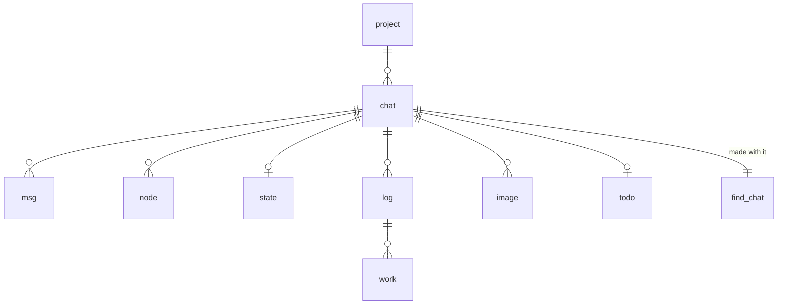
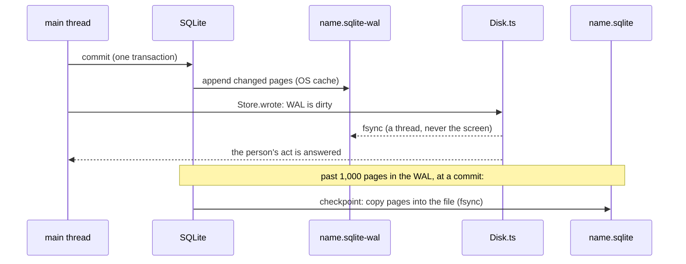

The chat files
==============

Everything illi remembers lives in SQLite files, one per project. This
page covers exactly how a file is laid out, who opens it, how a write
reaches the disk, how versions work, how search and forgetting work,
and what each costs. Each part names the function that does the work. If
this page and the code disagree, the code is right and this page needs
fixing.

- [Where they are](#where-they-are)
- [What is in a file](#what-is-in-a-file)
- [A file's settings](#a-files-settings)
- [Who opens them](#who-opens-them)
- [Opening, step by step](#opening-step-by-step)
- [Versions and upgrades](#versions-and-upgrades)
- [Writing and durability](#writing-and-durability)
- [Project locks](#project-locks)
- [The projects table](#the-projects-table)
- [Search](#search)
- [Forgetting a project](#forgetting-a-project)
- [Usage counts](#usage-counts)
- [Models](#models)
- [Known limits](#known-limits)

Where they are
--------------

| Profile         | Folder                                         |
| --------------- | ---------------------------------------------- |
| default         | `~/.illi/chat/projects/`                       |
| any other       | `~/.illi/profiles/<name>/chat/projects/`       |

`ILLI_DIR` moves `~/.illi`. The folder holds one file per project: one
for each git repo illi ran in, plus `home` for everywhere outside a repo
(`Projects.place`). A file is named after its project, such as
`app-k3f9x2.sqlite` (the repo folder's name plus a 6-character code from
its path) or `home.sqlite`.

While a file is open, SQLite keeps two more files beside it:
`app-k3f9x2.sqlite-wal` (new writes, see
[Writing](#writing-and-durability)) and `app-k3f9x2.sqlite-shm` (an index
into the WAL that the open connections share). When the last connection
closes cleanly, SQLite copies the WAL into the file and deletes both, so
only the `.sqlite` file is left. (A bun:sqlite connection only really
closes once every statement it prepared is finalized; `Store.close` sees
to that: [Close](#one-write).)

What is in a file
-----------------

### Tables

Every project file has the same schema, created by `SCHEMA` in
`src/chat/Store.ts`.

| Table      | One row is                                      | Key                     | Written                        |
| ---------- | ----------------------------------------------- | ----------------------- | ------------------------------ |
| `meta`     | a fact about the file (today only `compat`)     | `key`                   | with the schema; by upgrades   |
| `project`  | the place illi ran in (one row per file)        | `id`                    | once, at the first run there   |
| `chat`     | the project's chat (one today, room for more)   | `id`                    | once, with its project         |
| `msg`      | a message, or one page of a long message        | `(chat, i)`             | once; never changed            |
| `node`     | a summary line over a run of messages           | `(chat, first, n)`      | once; never changed            |
| `state`    | a chat's saved view, pick, goal, cut…           | `chat`                  | written over                   |
| `log`      | an agent's log (a subagent's name and tag)      | `id`, unique `(chat, log)` | once                        |
| `work`     | one entry of an agent's log                     | `(log, i)`              | once; never changed            |
| `image`    | an image a message names (its bytes, its smaller copy for models) | `id`, unique `(chat, name)` | once (the name is its hash) |
| `todo`     | a chat's to-do list, whole                      | `chat`                  | written over                   |
| `find_<chat>` | one chat's search index (FTS5)               | `rowid`                 | one row with each new `node`   |

The columns, by table:

- **project**: `id`, `uid` (a random UUID), `key` (`git:<repo's top
  folder>` or `home`), `name` (the file's name without `.sqlite`),
  `path` (`""` for home), `made` (ISO date), `extra` (a JSON object, `{}`,
  for later use).
- **chat**: `id`, `uid`, `project` (references `project`), `made`,
  `extra`.
- **msg**: `chat`, `i` (its index in the chat: 0, 1, 2…), `kind` (`user`,
  `illi`, `tool`…, `recap`: illi's recap at a `/compact`), `text`, `date`, `size` (bytes as models read it),
  `images` (a JSON list of image names, or null), `line` (its summary line
  if it was written with one), `more` (1 if the next row is the same
  message continued), `cwd` (the folder illi ran in). A message longer
  than 30,000 characters (`Clip.ts CAP`), or with more than 20 images
  (`Memory.ts PICS`), is stored as several rows, its pages. Only the last
  page has `more` null. A partial index `msg_page` on `(chat) where more
  is not null` lists the continued pages, so a chat's count of whole
  messages costs nothing.
- **node**: `chat`, `first`, `n`, `text`. A line covers messages
  `first … first + n - 1`. The memory tree (`Memory.ts`) is binary: node
  (level `l`, index `i`) has `first = i · 2^l` and `n = 2^l`. The table
  doesn't depend on that shape: any `(first, n)` fits. A line built twice
  keeps the first one (`on conflict do nothing`), because a view may
  already show it. The index `node_end` on `(chat, first + n)` finds a
  chat's latest line at once.
- **state**: `chat`, `saved` (JSON: the chat's view, `seen` (the
  compactions' view), the pick, the goal, the suggested reply (so it
  shows again after a restart), the main agent, what ran, the
  cut, `show` and `top`, the last `/clear` or `/compact` recap: the
  chat's view starts there, so nothing before it is sent; `show`, where
  the screen shows messages whole from, may be before `top` (a
  `/compact` leaves the screen as it was); loaded, they are held to
  `top` ≤ `cut` ≤ the count and `show` ≤ `cut`, whatever was saved:
  `Memory.read`). It is
  never rebuilt from the facts, because the model's prompt cache depends
  on the saved view.
- **log**: `id`, `chat`, `log`, `name`. **work**: `log` (references
  `log`), `i`, `kind`, `text`, `date`. The agents' logs (`Logs.ts`): a
  name freed goes on to a new agent, with a log of its own (the name and
  a tag).
- **image**: `id`, `chat`, `name` (its hash, so an image pasted twice is
  kept once), `data` (bytes), `fit` (a smaller copy for models, or null:
  a JPEG's a JPEG, any other's a WebP). Images illi reads with its tools
  aren't kept: only the line saying what each was.
- **todo**: `chat`, `list` (JSON).
- **find_\<chat\>**: an FTS5 table with `text` (the line), `first` and `n`
  (stored but not indexed). Its tokenizer is `unicode61 remove_diacritics
  2`; see [Search](#search). FTS5 keeps each index in five more real
  tables, `find_<chat>_data`, `_idx`, `_content`, `_docsize` and
  `_config`.

### The rules the tables follow

1. **Facts are added, never changed.** `msg`, `node`, `work` and `image`
   rows are only inserted. Only `state` and `todo` are written over.
2. **Nothing deletes a row.** Forgetting a project deletes its whole
   file ([Forgetting](#forgetting-a-project)); no code deletes a message,
   a line or an image.
3. **A search index never loses a line.** So a chat's line count is its
   highest `rowid`, which [search](#search) relies on.
4. **A file holds one project.** `Store.place` adds a project row only to
   an empty file.

A file's settings
-----------------

| Setting (pragma)  | Value                     | Kept in             | Why |
| ----------------- | ------------------------- | ------------------- | --- |
| `application_id`  | `0x696c6c69` ("illi")     | the file            | marks the file as illi's |
| `user_version`    | `3`                       | the file            | the schema's version ([upgrades](#versions-and-upgrades)) |
| `journal_mode`    | `wal`                     | the file            | readers and the writer don't block each other |
| `synchronous`     | `normal`                  | each connection     | a commit doesn't wait for the disk; Disk.ts flushes |
| `foreign_keys`    | `on`                      | each connection     | a row can't name a chat or log that isn't there |
| `busy_timeout`    | `10000` ms                | each connection     | wait for another process's write instead of failing |

Defaults left as SQLite ships them: a page is 4,096 bytes, and
`wal_autocheckpoint` is 1,000 pages (about 4 MB). Nothing is ever deleted
inside a file, so it needs no `auto_vacuum` or `secure_delete`.

Who opens them
--------------

Several processes and threads can have a file open at once. SQLite
allows any number of readers and one writer at a time. A writer that
finds another writing waits up to `busy_timeout` (10 s) and then fails.
A write that fails so, or for a full disk, is told on the screen: a
command's (`/clear`, `/goal`...) as its answer; a save of the chat's
state as a turn starts or ends (what ran, the suggested reply) as a
note, illi going on.

| Who | Connection | When | Code |
| --- | --- | --- | --- |
| **The holder**: the illi that holds a project's lock and runs its chat (shown, or a profile left running hidden in a window) | read-write to its project's file, kept open until illi quits | always, one per project being used | `Memory.load` → `Store.open(dir, place)` |
| **A view**: a second terminal in the same project | read-write to the same file | to read exports, the tree and the projects list; the chat itself comes from the holder over a socket | `Term.ts term_reader` |
| **A look at other projects**: the projects list, a zoom or date into another project, an export of one, the image count before a forget | read-write to that project's file, opened for the read and closed right after | each time | `Store.visit` → `Store.peek` |
| **The search thread** (`Seeker.ts`) | its own connections, to each file a search covers, each closed after | each `search` the model calls | `Projects.seek` |
| **A profile export** | read-write to each file, for a snapshot | `/profile` export | `Profiles.ts profile_snapshot` |

Other projects' files are opened read-write even just to read, because
SQLite only deletes a WAL and `-shm` that a read-write connection closes
last: a read-only open of a closed file would leave both behind.

Each write is small (0.16 ms measured on a 2-million-message chat), so
another process rarely waits long.

Opening, step by step
---------------------

`Store.open(dir, place)` does this, in order:

1. Creates the `projects` folder if needed.
2. Picks the file: `projects/<place's name>.sqlite`.
3. **`Store.connect(file)`** opens or creates it, then sets
   `busy_timeout = 10000`, `foreign_keys = on` and `synchronous =
   normal`; `Store.wal` sets `journal_mode = wal` before anything is
   written, so a new file is in WAL mode from its first page (switching
   ignores `busy_timeout`, so it is retried every 10 ms for up to 10 s
   while another illi opening the file at the same moment holds it);
   `Store.schema` gives a new file the schema, and refuses one that
   needs a newer illi ([below](#versions-and-upgrades)).
4. **`Store.place`**, in one write transaction: an empty file gets the
   project's row, named after the file. A file holding this place's key
   is the project's own. A file holding another place's key (two paths
   whose 6-character codes collide, a 1 in 2 billion chance) is someone
   else's: the file is closed and step 2 tries `<name>-2.sqlite`, then
   `-3`, and so on. Then it finds the project's first chat, or creates it
   with an empty `find_<chat>`.

A file that won't open (not an SQLite file, say) stops illi at start
with one line naming it: *illi: chat: app-k3f9x2.sqlite won't open: file
is not a database*. Every error a chat file raises reads *chat: …*, and
`main.ts` prints it so, never as a crash.

Opening an existing file costs about 0.6 ms; making a new one about
30–45 ms, nearly all of it the fsyncs of its first commits and close.

Another project's file is opened with `Store.peek(file)`: the same
`Store.connect`, but never creating the file (a file forgotten meanwhile
fails to open), and its project and first chat read instead of placed.
`Store.visit(store, file, read)` wraps that: it passes the store's own
connection when the file is its own, else peeks, reads and closes, even
when the read throws.

Versions and upgrades
---------------------

A file's format is its schema: which tables exist and what they hold.
`user_version` is the schema's version, and every illi knows its own
(`VERSION` in `Store.ts`, now 3). At every connect, `Store.schema` reads
the file's:

- **0, a new file:** it gets the whole schema (`SCHEMA`) in one write
  transaction (`begin immediate`), which also sets `user_version` and
  `meta.compat` to 3. Inside the transaction illi checks the version
  again, because another illi opening the same new file at that moment
  may have just done it.
- **The same:** nothing happens.
- **Older (1 or 2):** illi refuses it: *illi: chat: app-k3f9x2.sqlite is
  of an older illi this one can't open: move it away to start the
  project fresh.* No such file is left: every one was brought to 3
  before the steps that did so went.
- **Newer:** illi reads `meta.compat`. If compat is at most its own
  version, the newer illi only *added* things, and this illi opens the
  file as it is. If compat is higher, illi refuses it: at start it stops
  with *illi: chat: app-k3f9x2.sqlite is of a newer illi: update illi to
  open it.*; the projects list leaves that project out and logs why.

`compat` is the lowest version that can still use the file safely.

### Rules for a later version

A later schema raises `VERSION`, puts its change in `SCHEMA` for new
files, and brings an older file up by steps, each in its own write
transaction that also sets the new `user_version` (checked again inside,
as above), so a crash mid-step rolls the step back whole.

- A step only adds (a table, an index, a column with a default), so an
  older illi keeps working; or it raises `compat`, as a step that moves
  where facts live must, because an older illi would look for them in
  the old place.
- A table made for each chat (as `find_<chat>` is) has to be made by
  everything that makes a chat (`Store.place` calls `Store.words`). A
  step adding another such table must create it when a chat is first
  used, because an older illi may still be creating chats without it, or
  else raise `compat`.
- A file made new and a file brought up by the steps end with the same
  schema.

Writing and durability
----------------------

### One write

Every write is one SQLite transaction (`Store.push`, `Store.nodes`,
`Store.save`…): a message's pages together, a batch of summary lines
with their index entries together. A transaction is all or nothing.

1. **Commit.** SQLite appends every page the transaction changed to the
   WAL. In `synchronous = normal` the commit does not wait for the disk:
   the pages are in the OS's cache, and the screen goes on.
2. **Flush (Disk.ts).** `Store.wrote` marks the WAL dirty. One flush
   runs at a time: it fsyncs every file marked since the last flush
   began, off the main thread (`FileHandle.sync`). Writes that arrive
   during a flush wait for the next one, so a burst of writes costs one
   or two fsyncs (group commit). A file gone since (`ENOENT`) needs none.
3. **Answer.** An act of the person's (a message sent, a pick, a
   setting) is answered only once the flush covering it is done. Quitting
   waits for it too (`Disk.synced` in `term_leave`).
4. **Checkpoint.** When the WAL passes 1,000 pages, the commit that
   crosses that mark also copies the WAL's pages into the file. SQLite
   fsyncs the WAL before copying and the file after. The WAL is then
   reused from its start. A checkpoint can't copy pages that a reader's
   snapshot still needs, so a long search can delay it.
5. **Close.** `Store.close` finalizes every statement the connection
   prepared, then closes it; the last connection to close checkpoints
   everything and deletes the WAL. Store prepares its statements itself
   (one per SQL text, kept for the connection's life) instead of using
   bun:sqlite's `db.query`, whose cache keeps only 20: a statement past
   those is left to the garbage collector, and until it's collected
   `close()` leaves the connection open, so it never checkpoints and the
   WAL stays beside the file.

What this guarantees:

- **illi crashes, or is killed:** nothing is lost. The OS already holds
  every committed write.
- **The machine crashes, or loses power:** at most the writes since the
  last finished flush are lost, and an act that was answered is never
  lost. A file is never left half-written.
- **Disk wear:** each write is the few 4 KB pages it touches, written to
  the WAL and later once into the file.

Project locks
-------------

One process at a time holds a project's chat. The lock lives in
`~/.illi/locks/` (a folder only you can open, mode 0700):

| File | Is |
| ---- | -- |
| `<code>.lock` | the lock. `<code>` is a 12-character hash of the project's folder, or `home` (`Projects.lock`) |
| `<code>.sock` | the holder's socket (mode 0600), where a second terminal's view connects |

**Taking it** (`Lock.claim`, `Lock.grip`, src/chat/Lock.ts): illi opens the lock file as an
SQLite database, sets `busy_timeout = 50` ms (`GRIP`) and `journal_mode
= memory` (no journal file is left behind), and runs `begin exclusive`.
If that succeeds, the transaction stays open as long as the process
lives. The OS releases it however the process ends, so a crash never
leaves a stale lock.

**Why wait 50 ms:** without a wait, several illis starting at the same
moment each took a shared lock and then all failed to take it
exclusively, so nobody won. With a short wait, SQLite's deadlock
avoidance lets exactly one through. On a very busy machine the window
can be missed. Then every illi becomes a view, waits 15 s for a holder
that isn't there (`Remote.ts MUTE`), and runs again.

**If another illi holds it:** this one becomes a view of that chat
(`Remote.ts`), connected over the socket.

**Forgetting another project** takes that project's lock (without a
socket) while it deletes the file, so no illi starts that project
meanwhile. If an illi already has it open, illi refuses the forget.

The projects table
------------------

`Store.projects` builds what `/projects` shows and what the model's
`projects` tool returns: each project's name, folder, first and last
message dates, message count, and latest summary line, the one used last
first.

It lists the `.sqlite` files in the folder and reads each one
(`Store.visit`, so other projects' files are opened and closed again;
`Store.about`). A file that won't read is left out and logged (*illi:
the chat in … won't read: …*); one deleted meanwhile is left out
quietly.

For each chat it runs four small queries, all by index: the first
message, the last message, the count of continued pages (subtracted to
count whole messages), and the latest line. Two of them name their index
(`indexed by msg_page`, `indexed by node_end`). The files keep no table
statistics, and without them SQLite's planner picked a full scan of the
chat's rows: 161 ms for one query on a 2-million-line chat, against
0.0 ms by index.

With 100 projects, the list takes 39 ms.

Search
------

The model's `search` tool finds summary lines by their words, in this
project, in another one by name, or in `all`. Every line ever written can
be found, however old: nothing is capped by age.

### The thread

`Projects.seek` sends each search to one worker thread
(`src/chat/Seeker.ts`), started at the first search and never keeping
illi from quitting (`ref: false`). For each search the worker:

1. opens this project's file (`Store.peek`);
2. runs `Projects.search`, the same code the main thread would run,
   which opens every other file the search covers and closes each after;
3. sends back the text, or the error;
4. closes its connection (`Store.close`, so it really closes at once).

The main thread never waits: during a 2.9 s search on a 2-million-line
chat it kept drawing the screen (its longest gap was 14 ms). If the
worker can't start, or a message can't be posted, the search runs on the
main thread instead (`Projects.here`). If the worker dies, every search
still waiting on it runs on the main thread, and the next search starts
a new worker. In the compiled binary, the worker's code is a second
entry of the build (`src/chat/Seeker.ts` in `package.json`'s `build`,
`install.sh` and the release workflow), found at `./chat/Seeker.ts`.

### Projects.search

1. Splits the words on whitespace.
2. Picks the files: `""` means this project's; a name means that
   project's (`Store.lookup`, which only matches a file in the folder, so
   a name can't point anywhere else; an unknown name answers *No project
   X: projects lists them.*); `all` means every project's.
3. Calls `Store.search`, then writes each line as `project first+n|text`,
   its newlines flattened to spaces. With nothing found it says so,
   naming the scope.
4. In `all`, if lines were left out (step 4 of `Store.search` keeps 20),
   it adds a last line naming the projects they're in, the most first,
   with how many: *More lines in: app-k3f9x2 (12+), site-7q2m0d (3);
   search with project to see them.* A `+` means a chat of that project
   gave its most (20), so it may hold more still. The model can then
   search that project alone.

### Store.search

1. **Words to terms.** It keeps only words with at least one letter,
   digit or private-use character (Unicode `\p{L}`, `\p{N}`, `\p{Co}`).
   These are the characters the tokenizer indexes; a word like `—` would
   match nothing. With no term left, it returns nothing.
2. **Each file** (`Store.lines`): its chats are read inside one read
   transaction, so the file is seen as it was when its first read began.
   Another project's file that won't open (forgotten meanwhile) gives no
   lines; an error in this project's own file is thrown.
3. **Each chat** gives up to 20 lines from its own index (`Store.seek`),
   ranked by bm25.
4. **Merge.** Sorted by rank within its chat first, then by score: every
   chat's best line, best first; then every chat's second; and so on.
   The first 20 are kept; the rest are counted by project (`cut`), for
   the *More lines in* line above. A chat's bm25 scores weigh each word
   by how rare it is *in that chat*, so scores from a big chat and a
   small one can't be compared. Sorted by raw score, one big chat's
   matches would fill all 20 places and hide every small project's. With
   many projects, though, each gets only a line or two: 20 projects with
   matches give one line each.
5. **AND, then OR.** First a line must hold *all* the terms. If nothing
   matches and there was more than one term, it searches again for
   lines holding *any* of them.

### Store.seek: one chat

1. **Quoting.** Each term goes in double quotes (a `"` inside is
   doubled), so words like `AND`, `NOT`, `NEAR` or `ab*` are plain words,
   never FTS5 operators. Terms are joined by a space (AND) or by ` OR `.
2. **Tokenizing.** FTS5's `unicode61` tokenizer, with
   `remove_diacritics 2`, lowercases everything, strips accents
   (`café` matches `cafe`, `Über` matches `uber`), and splits on anything
   that isn't a letter or digit. A quoted word with punctuation becomes a
   phrase: `e-mail` matches the two tokens `e mail` side by side.
3. **The chat's size.** `lines` is the chat's highest rowid, its number
   of lines, since no line is ever deleted.
4. **Common words, in big chats only.** With more than `LARGE` (20,000)
   lines, each term is checked in three stretches of `SAMPLE` (1,000)
   lines: the newest, the middle and the oldest. Each check is one count
   query bounded by rowid. A term found in more than half the lines of
   *all three* stretches counts as common, and is left out of the query,
   as long as at least one term isn't common.
   - *Why it is safe:* FTS5's bm25 gives a word in more than half the
     lines a weight of almost nothing (its IDF is clamped to 0.000001),
     so leaving it out doesn't change the ranking.
   - *Why it matters:* matching such a word means reading its whole
     posting list, millions of entries in a big chat, which took
     seconds.
   - *The one effect:* with AND, a line no longer has to contain the
     common word. Searching `the sqlite` in a big chat finds the lines
     with `sqlite`.
   - *A word common only lately* (in the newest stretch but not the
     oldest) is kept, because it is still rare across the chat.
   - *If every term is common,* all are kept and the search reads them
     all. That is the slow case, and it runs in the worker.
5. **The query.** `select first, n, text, bm25(...) ... where ... match
   ? order by score limit 20`. A lower bm25 score is a better match.

### What search costs

Measured on a 2-million-message chat (8.6 GB, in RAM):

| Search | Time |
| ------ | ---- |
| a rare word | 0.4 ms |
| a word in 1 of 1,000 lines | 6 ms |
| a common word next to a rare one | 6.6 ms |
| a few common words | 245–454 ms |
| only the most common word (`the`) | 2.9 s, in the worker, the screen unaffected |

Across projects, each file is opened anew for each search (about 0.4 ms
a file). Measured on WSL2, ext4: an `all` search of 100 small projects
took 47–107 ms, and of 6 projects of 150,000 lines each 172–181 ms.

Forgetting a project
--------------------

### What you do

1. `/projects`, pick a project, press Delete.
2. Choose **Cancel** (lit at first), **Export a copy first, then
   forget**, or **Forget**. The export writes
   `./illi-project-<name>.json` in the current folder, and refuses if
   that file exists.

### What illi does

**Another project** (`project_forget`, `project_held`):

1. It takes that project's lock. If another illi has the project open,
   it stops: *open in another terminal: quit illi there first*.
2. It deletes the project's file (`Store.forget`).
3. It lets the lock go and says what was forgotten: *Forgot app-k3f9x2:
   1,204 messages and 3 images.*

**The project you're in** (only from the illi that holds it; a view is
told to forget it in the holder's terminal):

1. It closes the chat but keeps the lock, so no other illi can open the
   project meanwhile.
2. It deletes the project's file (`Store.forget`).
3. It runs illi again in the same terminal, which starts this project
   fresh in a new file.

A project already gone (forgotten in another terminal meanwhile) is
said so: *app-k3f9x2 is forgotten already.*

### Store.forget

It deletes `<name>.sqlite`, then its `-wal` and `-shm` if there (a
crash's, or another connection's still open), then fsyncs the folder, so
a power cut right after can't bring the file back. The file goes first,
so no connection opens it after. It takes no time, whatever the project's
size, and all of the project goes at once: its messages, summary lines,
images, logs and search index, and its space. A crash between the three
deletes leaves a `-wal` (and `-shm`) with no file beside them; the next
start in that project makes an empty file, and SQLite deletes a WAL it
finds beside an empty file instead of replaying it, so nothing of the
forgotten chat comes back.

Another illi may have the file open at that moment (a search, the
projects list, a zoom). That is safe:

- A connection that had read from the file goes on reading it as it
  was: on Linux and macOS a deleted file lives on until its last open
  descriptor closes.
- A connection that had opened the file but not read yet fails its first
  read, so that project is left out (a search gives none of its lines).
- When such a connection closes, SQLite first checks the file is still
  the one it opened, and since it isn't, it neither checkpoints nor
  deletes a WAL. So a new file made meanwhile at the same name (the
  project started again) keeps its WAL. The test *a project forgotten is
  gone, its file deleted…* checks exactly that.

### What "gone" means, exactly

The file is deleted: no illi can read the project again, and its space
goes back to the file system. Like any deleted file, its bytes stay on
the disk until the file system reuses those blocks; illi doesn't
overwrite them. Neither illi nor the file system can reach:

- **SSDs**, which move and erase blocks on their own schedule.
- **Snapshots and backups** made before the forget (Time Machine, btrfs
  snapshots, a VM's or WSL's disk image snapshots).
- **The export** you asked for, if you picked *Export a copy first*.

Usage counts
------------

`~/.illi/used.json` (the commands you type) and `~/.illi/picked.json`
(the rows you pick in Ctrl+P) each map a name to a weight
(`Commands.ts term_tally_one`):

1. Each use multiplies every weight by `0.5^(1/100)` (about 0.9931), so a
   use counts half as much 100 uses later.
2. A weight under 0.1, or one that isn't a number, is deleted. A name
   used once and never again disappears after 333 other uses.
3. The used name gets +1. A name used every single time levels off near
   145, so no weight grows without end.
4. Each illi reads the file once, at its first use, and counts in
   memory from then on. Its uses are also queued.
5. 2 s after the last use (a timer that never holds illi open,
   `term_tally_keep`), it reads the file again, as another illi may have
   written it meanwhile, and replays its queued uses over it (fade, +1,
   each in order). It writes the result, each weight rounded to three
   decimals, to `used.json.<pid>` beside it, then renames that over the
   file, so no reader ever sees half a file. The result becomes its
   counts in memory too. Two illis writing in the same instant can still
   lose one's batch; a failure to write is silent and keeps nothing.
   Uses queued when illi quits within those 2 s are not kept.

Fading counts uses, not days: a month away from illi changes nothing.

Models
------

`~/.illi/models.json` keeps what the vendors told of their models, for
the next start (`Config.ts config_models_keep`):
`{ at, vendors: { <vendor>: [model…] }, account?, capped? }`, a model
being `{ label, id, speeds, window, standard?, efforts?, tiers? }`.

1. `chatgpt`'s list is the account's catalog as it last answered
   (`ChatGPT.ts models`); `account` names whose it is, and `capped` the
   models that account refused past their usual window, which keep that
   window as their whole one. `claude-api`'s and `claude-code`'s hold
   the windows Anthropic's Models API and Claude Code told.
2. Each write is one vendor's list: illi reads the file as it is now,
   puts that vendor's list in, leaves the others' as they are, writes
   the whole to `models.json.<pid>.tmp` and renames it over the file,
   so no reader sees half a file and one vendor's learning never drops
   another's. Two illis writing in the same instant can still lose one's
   list, told again at the next answer.
3. At the start (`config_models`), the chatgpt list is taken whole,
   whatever its account (the login isn't read yet), until the catalog
   answers; the other vendors' entries only set the windows of the
   models illi has built in. A file that won't read is none: the
   built-in windows hold.

Known limits
------------

- **An `all` search gives 20 lines in all,** shared out across the
  projects with matches, so with many projects each gets a line or two.
  The rest are named, not shown (*More lines in: …*).
- **Each search opens every file it covers anew,** about 0.4 ms a file.
  A worker that kept its connections open would avoid that.
- **A search keeps a snapshot of a file for as long as it reads it,** so
  a checkpoint can't finish behind it.
- **An illi started in a project just as another illi forgets it** finds
  the project's lock held, joins as a view, finds no chat to join and
  runs again on its own (`Term.ts term_gone`), as it does after a
  holder quits; once the forget is done it starts the project fresh.
- **Two illis starting at the same moment on a very busy machine** can
  both miss the 50 ms lock window; both then wait 15 s and run again.
