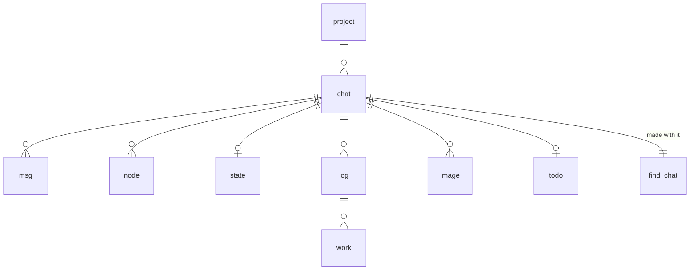
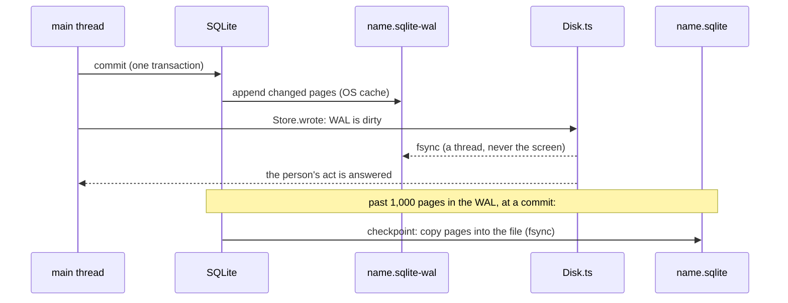
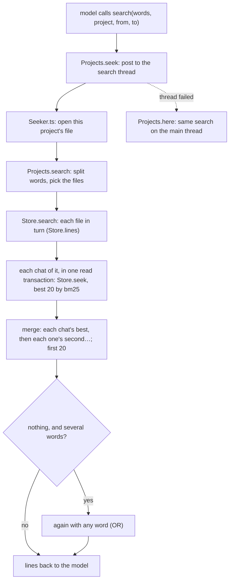

The chat files
==============

Every chat illi keeps lives in SQLite files, one per project in each
profile. This page covers exactly how a file is laid out, who opens
it, how a write reaches the disk, how versions work, how search and
forgetting work, and what each costs. Each part names the function that
does the work. If this page and the code disagree, the code is right and
this page needs fixing.

- [Where they are](#where-they-are)
- [What is in a file](#what-is-in-a-file)
- [A file's settings](#a-files-settings)
- [Who opens them](#who-opens-them)
- [Opening, step by step](#opening-step-by-step)
- [Versions and upgrades](#versions-and-upgrades)
- [Writing and durability](#writing-and-durability)
- [Project locks](#project-locks)
- [The projects table](#the-projects-table)
- [Messages by date](#messages-by-date)
- [Search](#search)
- [Forgetting a project](#forgetting-a-project)
- [Usage counts](#usage-counts)
- [Related counts](#related-counts)
- [Models](#models)
- [Known limits](#known-limits)

Where they are
--------------

| Profile         | Folder                                         |
| --------------- | ---------------------------------------------- |
| default         | `~/.illi/chat/projects/`                       |
| any other       | `~/.illi/profiles/<name>/chat/projects/`       |

`ILLI_DIR` moves `~/.illi`. The profile is `ILLI_PROFILE`'s, else the
one used last in the project, else the one used last anywhere, else
the default (`Profiles.profile_pick`, [Profiles](profiles.md)). The
folder holds one file per project: one
for each git repo illi ran in, plus `home` for everywhere outside a repo
(`Projects.place`). A file is named after its project, such as
`app-k3f9x2.sqlite` (the repo folder's name plus a 6-character code from
its path) or `home.sqlite`.

While a file is open, SQLite keeps two more files beside it:
`app-k3f9x2.sqlite-wal` (new writes, see
[Writing](#writing-and-durability)) and `app-k3f9x2.sqlite-shm` (an index
into the WAL that the open connections share). When the last connection
closes cleanly, SQLite copies the WAL into the file and deletes both, so
only the `.sqlite` file is left. (A bun:sqlite connection only really
closes once every statement it prepared is finalized; `Store.close` sees
to that: [Close](#one-write).)

What is in a file
-----------------

### Tables

Every project file has the same schema, created by `SCHEMA` in
`src/chat/Store.ts`.

| Table      | One row is                                      | Key                     | Written                        |
| ---------- | ----------------------------------------------- | ----------------------- | ------------------------------ |
| `meta`     | a fact about the file (today only `compat`)     | `key`                   | with the schema; by upgrades   |
| `project`  | the place illi ran in (one row per file)        | `id`                    | once, at the first run there   |
| `chat`     | the project's chat (one today, room for more)   | `id`                    | once, with its project         |
| `msg`      | a message, or one page of a long message        | `(chat, i)`             | once; never changed            |
| `node`     | a summary line over a run of messages           | `(chat, first, n)`      | once; never changed            |
| `state`    | a chat's saved view, pick, goal, cut…           | `chat`                  | written over                   |
| `log`      | an agent's log (a subagent's name and tag)      | `id`, unique `(chat, log)` | once                        |
| `work`     | one entry of an agent's log                     | `(log, i)`              | once; never changed            |
| `image`    | an image a message names (its bytes, its smaller copy for models) | `id`, unique `(chat, name)` | once (the name is its hash) |
| `todo`     | a chat's to-do list, whole                      | `chat`                  | written over                   |
| `find_<chat>` | one chat's search index (FTS5)               | `rowid`                 | one row with each new `node`   |

The columns, by table:

- **project**: `id`, `uid` (a random UUID), `key` (`git:<repo's top
  folder>` or `home`), `name` (the file's name without `.sqlite`),
  `path` (`""` for home), `made` (ISO date), `extra` (a JSON object, `{}`,
  for later use).
- **chat**: `id`, `uid`, `project` (references `project`), `made`,
  `extra`.
- **msg**: `chat`, `i` (its index in the chat: 0, 1, 2…), `kind` (`user`,
  `illi`, `tool`…, `recap`: illi's recap at a `/compact`), `text`, `date`, `size` (bytes as models read it),
  `images` (a JSON list of image names, or null), `line` (its summary line
  if it was written with one), `more` (1 if the next row is the same
  message continued), `cwd` (the folder illi ran in). A message longer
  than 30,000 characters (`Clip.ts CAP`), or with more than 20 images
  (`Image.ts PICS`), is stored as several rows, its pages. Only the last
  page has `more` null. A partial index `msg_page` on `(chat) where more
  is not null` lists the continued pages, so a chat's count of whole
  messages costs nothing. Pages are the file's alone: the screen and the
  plugins' `message` hook get a long message once, whole, at its first
  page's index (`Chat.entry`).
- **node**: `chat`, `first`, `n`, `text`. A line covers messages
  `first … first + n - 1`. The memory tree (`Memory.ts`) is binary: node
  (level `l`, index `i`) has `first = i · 2^l` and `n = 2^l`. The table
  doesn't depend on that shape: any `(first, n)` fits. A line built twice
  keeps the first one (`on conflict do nothing`), because a view may
  already show it. The index `node_end` on `(chat, first + n)` finds a
  chat's latest line at once.
- **state**: `chat`, `saved` (JSON: the chat's view, `seen` (the
  compactions' view), the pick, the goal, the suggested reply (so it
  shows again after a restart), the main agent, what ran, the
  cut, `show` and `top`, the last `/clear` or `/compact` recap: the
  chat's view starts there, so nothing before it is sent; `show`, where
  the screen shows messages whole from, may be before `top` (a
  `/compact` leaves the screen as it was); loaded, they are held to
  `top` ≤ `cut` ≤ the count and `show` ≤ `cut`, whatever was saved:
  `Memory.read`). It is
  never rebuilt from the facts, because the model's prompt cache depends
  on the saved view.
- **log**: `id`, `chat`, `log`, `name`. **work**: `log` (references
  `log`), `i`, `kind`, `text`, `date`. The agents' logs (`Logs.ts`): a
  name freed goes on to a new agent, with a log of its own (the name and
  a tag). An agent that outgrew its model's window logs its recap as a
  `recap` entry; its calls then get its first note, its `user` entries
  and the log from its last recap on (`Logs.view`), the rest kept.
- **image**: `id`, `chat`, `name` (its hash, so an image pasted twice is
  kept once), `data` (bytes), `fit` (a smaller copy for models, or null:
  a JPEG's a JPEG, any other's a WebP). Images illi reads with its tools
  aren't kept: only the line saying what each was.
- **todo**: `chat`, `list` (JSON).
- **find_\<chat\>**: an FTS5 table with `text` (the line), `first` and `n`
  (stored but not indexed). Its tokenizer is `unicode61 remove_diacritics
  2`; see [Search](#search). FTS5 keeps each index in five more real
  tables, `find_<chat>_data`, `_idx`, `_content`, `_docsize` and
  `_config`.



### The rules the tables follow

1. **Facts are added, never changed.** `msg`, `node`, `work` and `image`
   rows are only inserted. Only `state` and `todo` are written over.
2. **Nothing deletes a row.** Forgetting a project deletes its whole
   file ([Forgetting](#forgetting-a-project)); no code deletes a message,
   a line or an image.
3. **A search index never loses a line.** So a chat's line count is its
   highest `rowid`, which [search](#search) relies on.
4. **A file holds one project.** `Store.place` adds a project row only to
   an empty file.

A file's settings
-----------------

| Setting (pragma)  | Value                     | Kept in             | Why |
| ----------------- | ------------------------- | ------------------- | --- |
| `application_id`  | `0x696c6c69` ("illi")     | the file            | marks the file as illi's |
| `user_version`    | `3`                       | the file            | the schema's version ([upgrades](#versions-and-upgrades)) |
| `journal_mode`    | `wal`                     | the file            | readers and the writer don't block each other |
| `synchronous`     | `normal`                  | each connection     | a commit doesn't wait for the disk; Disk.ts flushes |
| `foreign_keys`    | `on`                      | each connection     | a row can't name a chat or log that isn't there |
| `busy_timeout`    | `10000` ms                | each connection     | wait for another process's write instead of failing |

Defaults left as SQLite ships them: a page is 4,096 bytes, and
`wal_autocheckpoint` is 1,000 pages (about 4 MB). Nothing is ever deleted
inside a file, so it needs no `auto_vacuum` or `secure_delete`.

Who opens them
--------------

Several processes and threads can have a file open at once. SQLite
allows any number of readers and one writer at a time. A writer that
finds another writing waits up to `busy_timeout` (10 s) and then fails.
A write that fails so, or for a full disk, is told on the screen: a
command's (`/clear`, `/goal`...) as its answer; a save of the chat's
state as a turn starts or ends (what ran, the suggested reply) as a
note, illi going on.

| Who | Connection | When | Code |
| --- | --- | --- | --- |
| **The holder**: the illi that holds a project's lock and runs its chat (shown, or a profile left running hidden in a window) | read-write to its project's file, kept open until illi quits | always, one per project and profile in use | `Memory.load` → `Store.open(dir, place)` |
| **A view**: an illi started where another holds the project's chat, in the same profile (a second terminal's, a pipe's) | read-write to the same file, kept open until illi quits | to read exports, the tree and the projects list; the chat itself comes from the holder over a socket | `Term.ts term_reader` |
| **A look at other projects**: the projects list, a zoom or date into another project, an export of one, the image count before a forget | read-write to that project's file, opened for the read and closed right after | each time | `Store.visit` → `Store.peek` |
| **The search thread** (`Seeker.ts`) | its own connections, to each file a search covers, each closed after | each `search` the model calls | `Projects.seek` |
| **The radar's thread** (`Seeker.ts`, a second worker) | its own connection to this project's file, closed after each search | after each step of a turn, with `related` on | `Projects.radar` |
| **Recall's thread** (`Seeker.ts`, a third worker) | its own connection to this project's file, closed after each search | as a tool call runs, one at a time, with `related` on | `Projects.recall` |
| **A profile export** | read-write to each file, for a snapshot | `/profile` export | `Profiles.ts profile_snapshot` |

Other projects' files are opened read-write even just to read, because
SQLite only deletes a WAL and `-shm` that a read-write connection closes
last: a read-only open of a closed file would leave both behind.

Each write is small (0.16 ms measured on a 2-million-message chat), so
another process rarely waits long.

Opening, step by step
---------------------

`Store.open(dir, place)` does this, in order:

1. Creates the `projects` folder if needed.
2. Picks the file: `projects/<place's name>.sqlite`.
3. **`Store.connect(file)`** opens or creates it, then sets
   `busy_timeout = 10000`, `foreign_keys = on` and `synchronous =
   normal`; `Store.wal` sets `journal_mode = wal` before anything is
   written, so a new file is in WAL mode from its first page (switching
   ignores `busy_timeout`, so it is retried every 10 ms for up to 10 s
   while another illi opening the file at the same moment holds it);
   `Store.schema` gives a new file the schema, and refuses one that
   needs a newer illi ([below](#versions-and-upgrades)).
4. **`Store.place`**, in one write transaction: an empty file gets the
   project's row, named after the file. A file holding this place's key
   is the project's own. A file holding another place's key (two paths
   whose 6-character codes collide, a 1 in 2 billion chance) is someone
   else's: the file is closed and step 2 tries `<name>-2.sqlite`, then
   `-3`, and so on. Then it finds the project's first chat, or creates it
   with an empty `find_<chat>`.

A file that won't open (not an SQLite file, say) stops illi at start
with one line naming it: *illi: chat: app-k3f9x2.sqlite won't open: file
is not a database*. Every error a chat file raises reads *chat: …*, and
`main.ts` prints it so, never as a crash.

Opening an existing file costs about 0.6 ms; making a new one about
30–45 ms, nearly all of it the fsyncs of its first commits and close.

Another project's file is opened with `Store.peek(file)`: the same
`Store.connect`, but never creating the file (a file forgotten meanwhile
fails to open), and its project and first chat read instead of placed.
`Store.visit(store, file, read)` wraps that: it passes the store's own
connection when the file is its own, else peeks, reads and closes, even
when the read throws.

Versions and upgrades
---------------------

A file's format is its schema: which tables exist and what they hold.
`user_version` is the schema's version, and every illi knows its own
(`VERSION` in `Store.ts`, now 3). At every connect, `Store.schema` reads
the file's:

- **0, a new file:** it gets the whole schema (`SCHEMA`) in one write
  transaction (`begin immediate`), which also sets `user_version` and
  `meta.compat` to 3. Inside the transaction illi checks the version
  again, because another illi opening the same new file at that moment
  may have just done it.
- **The same:** nothing happens.
- **Older (1 or 2):** illi refuses it: *illi: chat: app-k3f9x2.sqlite is
  of an older illi this one can't open: move it away to start the
  project fresh.* No such file is left: every one was brought to 3
  before the steps that did so went.
- **Newer:** illi reads `meta.compat`. If compat is at most its own
  version, the newer illi only *added* things, and this illi opens the
  file as it is. If compat is higher, illi refuses it: at start it stops
  with *illi: chat: app-k3f9x2.sqlite is of a newer illi: update illi to
  open it.*; the projects list leaves that project out and logs why.

`compat` is the lowest version that can still use the file safely.

### Rules for a later version

A later schema raises `VERSION`, puts its change in `SCHEMA` for new
files, and brings an older file up by steps, each in its own write
transaction that also sets the new `user_version` (checked again inside,
as above), so a crash mid-step rolls the step back whole.

- A step only adds (a table, an index, a column with a default), so an
  older illi keeps working; or it raises `compat`, as a step that moves
  where facts live must, because an older illi would look for them in
  the old place.
- A table made for each chat (as `find_<chat>` is) has to be made by
  everything that makes a chat (`Store.place` calls `Store.words`). A
  step adding another such table must create it when a chat is first
  used, because an older illi may still be creating chats without it, or
  else raise `compat`.
- A file made new and a file brought up by the steps end with the same
  schema.

Writing and durability
----------------------

### One write

Every write is one SQLite transaction (`Store.push`, `Store.nodes`,
`Store.save`…): a message's pages together, a batch of summary lines
with their index entries together. A transaction is all or nothing.



1. **Commit.** SQLite appends every page the transaction changed to the
   WAL. In `synchronous = normal` the commit does not wait for the disk:
   the pages are in the OS's cache, and the screen goes on.
2. **Flush (Disk.ts).** `Store.wrote` marks the WAL dirty. One flush
   runs at a time: it fsyncs every file marked since the last flush
   began, off the main thread (`FileHandle.sync`). Writes that arrive
   during a flush wait for the next one, so a burst of writes costs one
   or two fsyncs (group commit). A file gone since (`ENOENT`) needs none.
3. **Answer.** An act of the person's (a message sent, a pick, a
   setting) is answered only once the flush covering it is done. Running
   again in place (a switch with illi alone, a rename, a chat moved, the
   project forgotten) waits for it too (`Disk.synced` in
   `ProfileCommands.ts term_leave`); a quit doesn't, its close
   checkpointing (and so fsyncing) a file it is the last to close.
4. **Checkpoint.** When the WAL passes 1,000 pages, the commit that
   crosses that mark also copies the WAL's pages into the file. SQLite
   fsyncs the WAL before copying and the file after. The WAL is then
   reused from its start. A checkpoint can't copy pages that a reader's
   snapshot still needs, so a long search can delay it.
5. **Close.** `Store.close` finalizes every statement the connection
   prepared, then closes it; the last connection to close checkpoints
   everything and deletes the WAL. Store prepares its statements itself
   (one per SQL text, kept for the connection's life) instead of using
   bun:sqlite's `db.query`, whose cache keeps only 20: a statement past
   those is left to the garbage collector, and until it's collected
   `close()` leaves the connection open, so it never checkpoints and the
   WAL stays beside the file.

What this guarantees:

- **illi crashes, or is killed:** nothing is lost. The OS already holds
  every committed write.
- **The machine crashes, or loses power:** at most the writes since the
  last finished flush are lost, and an act that was answered is never
  lost. A file is never left half-written.
- **Disk wear:** each write is the few 4 KB pages it touches, written to
  the WAL and later once into the file.

Project locks
-------------

One process at a time holds a project's chat in a profile. The lock
lives in the profile's `locks/` (`~/.illi/locks/`, another profile's
`~/.illi/profiles/<name>/locks/`; a folder only you can open, mode
0700):

| File | Is |
| ---- | -- |
| `<code>.lock` | the lock. `<code>` is a 12-character hash of the project's folder, or `home` (`Projects.lock`) |
| `<code>.sock` | the holder's socket (mode 0600), where a second terminal's view connects |

Each profile's illi takes it as it starts (`Term.ts term_start`): on a
terminal, the members under the window, shown or hidden; alone
(`ILLI_WINDOW=off`) or from a pipe, illi itself. The window process
(`Window.ts`) holds no lock and writes no file: it copies bytes between
the terminal and its members' pseudo-terminals.

**Taking it** (`Lock.claim`, `Lock.grip`, src/chat/Lock.ts): illi opens the lock file as an
SQLite database, sets `busy_timeout = 50` ms (`GRIP`) and `journal_mode
= memory` (no journal file is left behind), and runs `begin exclusive`.
If that succeeds, the transaction stays open while this illi holds the
chat: till it quits, or lets go to run again in place (`Lock.release`);
a profile switched away from in a window holds on, hidden. The OS
releases it however the process ends, so a crash never leaves a stale
lock.

**Why wait 50 ms:** without a wait, several illis starting at the same
moment each took a shared lock and then all failed to take it
exclusively, so nobody won. With a short wait, SQLite's deadlock
avoidance lets exactly one through. On a very busy machine the window
can be missed. Then every illi becomes a view, finds no holder's
socket, and runs again 600 ms later (`Term.ts term_gone`), 20 times in
a row at most (`REJOIN`).

**If another illi holds it:** this one becomes a view of that chat
(`Remote.ts`), connected over the socket.

**Forgetting another project** takes that project's lock (without a
socket) while it deletes the file, so no illi starts that project
meanwhile. If an illi already has it open, illi refuses the forget.

**Renaming or deleting a profile, or moving its chat into a new one,**
first tries each lock in that profile's `locks/` and lets it go at once
(`Lock.others`); one held refuses it (*illi runs in profile work in
another terminal*), as a profile running hidden in this window is
refused a rename or delete.

The projects table
------------------

`Store.projects` builds what `/projects` shows and what the model's
`projects` tool returns: each project's name, folder, first and last
message dates, message count, and latest summary line, the one used last
first. Both show each date as its day in illi's zone (`When.ymd`), the
zone of the time now each call is told, never the UTC day its ISO
instant starts with.

It lists the `.sqlite` files in the folder and reads each one
(`Store.visit`, so other projects' files are opened and closed again;
`Store.about`). A file that won't read is left out and logged (*illi:
the chat in … won't read: …*); one deleted meanwhile is left out
quietly.

For each chat it runs four small queries, all by index: the first
message, the last message, the count of continued pages (subtracted to
count whole messages), and the latest line. Two of them name their index
(`indexed by msg_page`, `indexed by node_end`). The files keep no table
statistics, and without them SQLite's planner picked a full scan of the
chat's rows: 161 ms for one query on a 2-million-line chat, against
0.0 ms by index.

With 100 projects, the list takes 39 ms.

Messages by date
----------------

Ask illi what you did yesterday afternoon or last Tuesday, and it works
the dates out itself: each call's message names the time now after the
working dir, as `Now: Sun 2026-10-25 14:05 UTC-4` (`Tools.here`,
`When.now`; on `claude-code` without the date, which Claude Code's own
prompt gives). The line is built once a call and sits after every cache
mark a later call reads, so a new minute never costs a cached prefix.
One `date` call then shows that stretch, or one `search` finds words
in it.

The model's `date` tool goes both ways: `date(id)` reads message id's
`date` and says it in illi's zone (`Wed 21 Oct 2026 14:05`,
`When.moment`); `date(from, to)` finds the messages of a span of time, and
`search` takes the same `from` and `to`. The span is read in illi's
local zone (`When.span`, `src/chat/When.ts`): a date alone as `from` is
its day's start, as `to` its day's end (a month, `2026-10`, or a year
alike; `today` and `yesterday` are days, `now` an instant), a time as
`to` the instant the span stops before, and `to` left out the end of
what `from` names (a time's day). An ISO time with its zone
(`2026-10-21T14:00:00Z`, `+02:00`) is that instant. A field sent as
null or blank, as a model may send one it means to leave out, counts
as left out (`When.given`); in `search`, `to` alone spans from the
first message on (`date` needs `from`). A date that isn't one, or a
`to` before `from`, is refused by `date`, saying why; `search` then
searches every date, its result saying the span was left out and why.
Each message's `date` is an ISO instant, compared as one
(`Date.parse`), never as text.

`Store.span(store, span)` gives the span's messages as `[a, b)`, the
first and the one after the last, with no index and no scan:

1. **The count:** `max(i) + 1` by the primary key (`Store.count`).
2. **Each end by bisection** (`Store.since`): the first message dated at
   the bound or later, by point reads of `select date, more from msg
   where chat = ? and i = ?`, planned as `SEARCH msg USING PRIMARY KEY
   (chat=? AND i=?)`. Messages are logged as they come, so their dates
   rise, and about log2(n) reads find the bound: 21 for 2 million.
3. **Whole messages** (`Store.first`): a bound that falls on a later page
   of a message moves on past its pages, so a message stands where its
   first page is dated. Each page takes the time as it is logged
   (`Memory.root`), so a message's pages may differ by a millisecond;
   a span never splits one.
4. **A clock set back** leaves dates out of order. The bisection ends all
   the same, at a message dated at the bound or later whose one before
   is dated earlier (or at 0, or the count): a message logged while the
   clock was off may fall on the wrong side of a span's end, never
   anything worse. `b` is held at `a` or later.

No schema change was needed. Measured on synthetic chats (WSL2, ext4,
Bun 1.4.3; each message 200 characters, the median of 9 random days):
0.18 ms at 200,000 messages, 0.21 ms at 2 million.

`Memory.days` turns `[a, b)` into the tool's answer, from lines the
compactor built already (no model is asked):

1. **A head:** the span (`Wed 21 Oct 2026`), its messages (`214
   messages`), the times of the first and the last (`09:12–23:40`).
2. **The lines** (`Memory.lines`): first the tree's roots over `[a, b)`
   (`Memory.roots`, the coarsest lines that tile the chat), then a batch
   at a time, those not built first, else every line of the largest
   size, each split into its two halves (those that reach `[a, b)`),
   while the lines stay 12 at most (`SPAN_LINES`) and their texts 4,800
   bytes (`SPAN_BYTES`, about 1,200 tokens). A few messages each get a
   line; a busy month gets lines of many messages, never more lines. A
   line not built that can't split (a message, or no room) reads
   *(not summarized yet: zoom it)*, and zoom opens it all the same. The
   roots alone can pass both, one for each set bit of the chat's count
   (13 roots over a chat of 8,191), and nothing coarser covers them: they
   stay, and past the bytes each text is cut to an even share. Each line
   reads its first and last message's dates (`Store.date`), two point
   reads.
3. **Each line** is `id+n|` (so zoom takes it), its times with only what
   the head doesn't say (`When.range`: `14:05–16:40` within the span's
   one day; `Thu 22 09:10` off it, or in a span of days), then its text.
4. **Last,** how to go deeper: *Zoom a line to go deeper* (in another
   project's chat, naming it: zoom takes the project too).

A span with no message says so (*Nothing on Sun 18 Oct 2026*) with the
lines just before and after it (`Memory.near`): the largest built line
of at most 8 messages ending just before it, and the one starting where
it ends (none built: the message alone).

With `project`, it reads that project's chat, its file opened and closed
again (`Tools.chat_of`, as zoom and `date(id)` do).

Search
------

The model's `search` tool finds summary lines by their words, in this
project, in another one by name, or in `all`. Every line ever written can
be found, however old: nothing is capped by age. The radar (the side
panel's Related lines, and the strong ones given to the model,
[below](#the-radar)) reads the same index, in threads of its own, so a
search the model asks never waits on it.



### The thread

`Projects.seek` sends each search to a worker thread
(`src/chat/Seeker.ts`), started at the first search and never keeping
illi from quitting (`ref: false`). `Projects.radar` sends the radar's to
a second worker of the same module, started at the radar's first, so a
search the model asks never queues behind one of the radar's, and
`Projects.recall` sends recall's to a third (started as a turn starts,
with `related` on: a worker takes longer to start than a call's end
waits on its search), so the side's never queues behind one of
recall's either: a search can't be cut off, and one whose answer came
too late still runs to its end (`Projects.thread` posts to any of
them: each its own worker and its own searches waiting). A message is
`{ id, file, $: "search", words, scope, span }` (span: the `from` and
`to` asked, in ms, or null), `{ id, file, $: "radar", ask }` or
`{ id, file, $: "recall", ask }`, answered `{ id, out }` or
`{ id, error }`. For each the worker:

1. opens this project's file (`Store.peek`);
2. runs `Projects.search`, the same code the main thread would run,
   which opens every other file the search covers and closes each after
   (the radar's: `Radar.search`; recall's: `Radar.recall`; both on this
   file alone);
3. sends back the text (the radar's lines, recall's line or none), or
   the error;
4. closes its connection (`Store.close`, so it really closes at once).

The main thread never waits: during a 2.9 s search on a 2-million-line
chat it kept drawing the screen (its longest gap was 14 ms). If the
worker can't start, or a message can't be posted, the search runs on the
main thread instead (`Projects.here`). If a worker dies, every search
still waiting on it runs on the main thread, and that thread's next
search starts a new worker; the other workers go on. The radar's and
recall's never run on the main thread: they fail, and the side shows
nothing new till the next step, or the call's result goes without a
line. In the compiled binary, the workers' code is a second
entry of the build (`src/chat/Seeker.ts` in `package.json`'s `build`,
`install.sh` and the release workflow), found at `./chat/Seeker.ts`:
all three workers start from that one entry.

### Projects.search

1. Splits the words on whitespace.
2. Picks the files: `""` means this project's; a name means that
   project's (`Store.lookup`, which only matches a file in the folder, so
   a name can't point anywhere else; an unknown name answers *No project
   X: projects lists them.*); `all` means every project's.
3. Calls `Store.search`, then writes each line as `project first+n|text`,
   its newlines flattened to spaces. With nothing found it says so,
   naming the scope, and the span if one was asked.
4. In `all`, if lines were left out (step 4 of `Store.search` keeps 20),
   it adds a last line naming the projects they're in, the most first,
   with how many: *More lines in: app-k3f9x2 (12+), site-7q2m0d (3);
   search with project to see them.* A `+` means a chat of that project
   gave its most (20), so it may hold more still. The model can then
   search that project alone.

### Store.search

1. **Words to terms.** It keeps only words with at least one letter,
   digit or private-use character (Unicode `\p{L}`, `\p{N}`, `\p{Co}`).
   These are the characters the tokenizer indexes; a word like `—` would
   match nothing. With no term left, it returns nothing.
2. **Each file** (`Store.lines`): its chats are read inside one read
   transaction, so the file is seen as it was when its first read began.
   Another project's file that won't open (forgotten meanwhile) gives no
   lines; an error in this project's own file is thrown.
3. **Each chat** gives up to 20 lines from its own index (`Store.seek`),
   ranked by bm25. With a span, each chat's messages in it are found
   first ([Messages by date](#messages-by-date)), and only lines over
   those messages alone count.
4. **Merge.** Sorted by rank within its chat first, then by score: every
   chat's best line, best first; then every chat's second; and so on.
   The first 20 are kept; the rest are counted by project (`cut`), for
   the *More lines in* line above. A chat's bm25 scores weigh each word
   by how rare it is *in that chat*, so scores from a big chat and a
   small one can't be compared. Sorted by raw score, one big chat's
   matches would fill all 20 places and hide every small project's. With
   many projects, though, each gets only a line or two: 20 projects with
   matches give one line each.
5. **AND, then OR.** First a line must hold *all* the terms. If nothing
   matches and there was more than one term, it searches again for
   lines holding *any* of them.

### Store.seek: one chat

1. **Quoting.** Each term goes in double quotes (a `"` inside is
   doubled), so words like `AND`, `NOT`, `NEAR` or `ab*` are plain words,
   never FTS5 operators. Terms are joined by a space (AND) or by ` OR `.
2. **Tokenizing.** FTS5's `unicode61` tokenizer, with
   `remove_diacritics 2`, lowercases everything, strips accents
   (`café` matches `cafe`, `Über` matches `uber`), and splits on anything
   that isn't a letter or digit. A quoted word with punctuation becomes a
   phrase: `e-mail` matches the two tokens `e mail` side by side.
3. **The chat's size.** `lines` is the chat's highest rowid, its number
   of lines, since no line is ever deleted.
4. **Common words, in big chats only.** With more than `LARGE` (20,000)
   lines, each term is checked in three stretches of `SAMPLE` (1,000)
   lines: the newest, the middle and the oldest. Each check is one count
   query bounded by rowid. A term found in more than half the lines of
   *all three* stretches counts as common, and is left out of the query,
   as long as at least one term isn't common.
   - *Why it is safe:* FTS5's bm25 gives a word in more than half the
     lines a weight of almost nothing (its IDF is clamped to 0.000001),
     so leaving it out doesn't change the ranking.
   - *Why it matters:* matching such a word means reading its whole
     posting list, millions of entries in a big chat, which took
     seconds.
   - *The one effect:* with AND, a line no longer has to contain the
     common word. Searching `the sqlite` in a big chat finds the lines
     with `sqlite`.
   - *A word common only lately* (in the newest stretch but not the
     oldest) is kept, because it is still rare across the chat.
   - *If every term is common,* all are kept and the search reads them
     all. That is the slow case, and it runs in the worker.
5. **The query.** `select first, n, text, bm25(...) ... where ... match
   ? order by score limit 20`. A lower bm25 score is a better match.
   With a span `[a, b)`, `and first >= ? and first + n <= ?` joins the
   `where`, so the best lines in the span are found, not the best of all
   cut down to it. An empty span asks nothing.

### What search costs

Measured on a 2-million-message chat (8.6 GB, in RAM):

| Search | Time |
| ------ | ---- |
| a rare word | 0.4 ms |
| a word in 1 of 1,000 lines | 6 ms |
| a common word next to a rare one | 6.6 ms |
| a few common words | 245–454 ms |
| only the most common word (`the`) | 2.9 s, in the worker, the screen unaffected |

Across projects, each file is opened anew for each search (about 0.4 ms
a file). Measured on WSL2, ext4: an `all` search of 100 small projects
took 47–107 ms, and of 6 projects of 150,000 lines each 172–181 ms.

### The radar

While illi works, the terminal searches the chat after each step for
past topics that may be related, and shows them at the side
(`src/term/Related.ts`; the search, `src/chat/Radar.ts`). One runs at a
time; a step that comes meanwhile asks again once it ends, and the stale
answer is dropped. In one read transaction, on the radar's worker's
connection:

1. **Each unit counted** (`Store.hits`): a unit is a phrase of index
   words made from the run (a path `src/chat/Memory.ts` as `"memory ts"`,
   a short one too, `db.ts`; a name `term_side_drawn` as
   `"term side drawn"`, an acronym like `MCP`; an error's name, an errno
   only by its name, `ENOENT`; a rare word). Every unit the run gives is
   sent, 200 at most. `select count(*) from (select 1 from find_<chat>
   where find_<chat> match ? limit 4001)`: read from the index's lists of
   where each word is, no line's columns. A unit in none, or in more
   than 4,000 lines, is dropped. Of the rest, the 24 that weigh most by
   that count go on (weight × idf, by lines: `Store.indexed`, the lines
   in all), so a rare word is never cut for where it sorts.
2. **Their lines** (`Store.held`): `select first, n from find_<chat>
   where find_<chat> match ? and first + n <= ? limit 4000`: only lines
   before the messages left out at the chat's end (the recent ones, and
   those the view holds at message detail just before them).
3. **Too common, dropped:** a unit in more than a tenth of the chat's
   episodes (each 16 messages; three at least, so a topic come back
   twice in a young chat still counts). Of the rest, the 12 that weigh
   most (weight × idf, by episodes).
4. **Widened** (`Store.node`): each line over nothing left out (the
   other messages at message detail, the dismissed) goes up to the
   highest built node over it of at most 16 messages that holds nothing
   left out.
5. **Scored**: each episode, the sum over the units it holds of
   weight × idf (by episodes). The 8 best that pass the floor get the
   date of their last message (`Store.date`).

So a search counts each unit sent (each count stops at 4,001), reads at
most 24 × 4,000 rows of `(first, n)`, a few dozen nodes and 8 dates.
Measured on synthetic chats (WSL2, ext4, Bun 1.4.3; the median of 7):

| The run's units | 20,000 messages | 200,000 messages |
| --- | --- | --- |
| a typical run's 14 | 10 ms | 17 ms |
| 24, each in more than 4,000 lines (dropped at the count) | 5 ms | 6 ms |
| 200, each in more than 4,000 lines | (only 20 such words) | 49 ms |
| 200 rare words (a long paste) | 20 ms | 31 ms |
| 200, each in just under 4,000 lines | 34 ms | 147 ms |
| 24, each in just under 4,000 lines: every row read, the worst | 93 ms | 183 ms |

The rows' lookups are most of it; a count costs little beside them
(looked up whole, before counting, the 24 common units took 79 ms and
98 ms). It runs in its own worker, so neither the screen nor the
model's `search` waits on it: a search the model asked during the worst
case above took 1.5 ms at 20,000 messages and 1.8 ms at 200,000, as it
does alone (when the two shared a worker, it waited 86 ms and 196 ms).

### Recall: the strong lines given to the model

As a tool call of illi's runs, the chat searches the same index for it
(`src/chat/Recall.ts`; the search, `Radar.recall`), so the model gets a
strong match without asking (a subagent started fresh, which gets
nothing of the chat, starts none). It starts beside the call's run, past
the hooks and the permission checks, on recall's own worker, one at a
time: a later call of the same caller's round of calls shares the one running
(so what a fast call's search found too late goes after a slower call
of that round instead of nowhere), any other call that starts meanwhile
gets none. In one read transaction, on that worker's connection:

1. **The run**, read from the file: the caller's latest user message,
   then its latest 16 messages after it (the chat's agent's from `msg`,
   a subagent's from its log in `work`), then the call itself, as it will
   be logged. Its units are made as the radar's are.
2. **The search** is the radar's (above), with what the caller's view
   leaves out:
   - the chat's agent: the view's lines before its cut, those of 16
     messages or fewer left out (what the view says of them is as fine
     as any line found there), and its recent messages from the cut on;
   - a subagent: the lines of the map it was given, those of 16
     messages or fewer left out;
   - and, for both, what the user dismissed at the side (sent to the
     chat over the view's pipe: `Chat.dismiss`, kept till illi quits).
3. **Strong only**: a line matching a path or an error's name, of two
   units at least, scoring at least the bar:
   - `STRONG` (15: three times the side's floor);
   - then, once 20 such lines were opened or pinned at the side, where
     the lowest quarter of them starts in `related.json` (up or down,
     never under 10). It is read again at most once a minute.
4. **Not named already**: `select text from msg where chat = ? and i >= ?
   and (text glob '*#[0-9]*' or text glob '*[0-9]+[0-9]*|*')` over the
   recent messages (a subagent's log in `work` as its calls get it: all
   of it till a recap; past one, its first entry, illi's messages to it
   and all from the last recap on), each read for
   `#1234+16`, `#1234` and `1234+16|`. A line overlapping one named
   there is skipped: a pin, a line given before, a zoom's or a search's
   output. Nothing is kept beside the chat, so this holds across
   restarts.

The best line left is appended to the call's result as one line,
`\n\n<history>#1234+16 · 3d ago · its summary</history>`, after what the
hooks added. It is appended only when:

- the search answered within 5 ms of the tool ending (else nothing, and
  the call is no slower);
- no other call of the same round of tool calls got one (`Chat.on`
  counts each caller's rounds);
- the result holds no images, and isn't empty (its "(no output)"
  stays as it is);
- the line would not push it onto a page of its own.

So a call quicker than its search gets no line of its own. On the
tests' chat of 1,600 messages a search took 1.4 ms on a worker already
running and 14 ms on one just started (hence the worker started with
the turn); a typical run's takes about 10 ms at 20,000 messages and 17
ms at 200,000 (the radar's table above). A read or an edit, done in a
millisecond or two, rarely waits long enough: a slower call of its
round (a command, an MCP tool) takes what the search found, and the
next round's search reads that call in the run.

It is logged with the result, as the model read it, so the next call's
cache holds. It is never read as part of the result: `history_bare`
(`Clip.ts`) takes that exact line off a result's end wherever one is
read.

- `Memory.source` gives a result's leaf without it, so the line is never
  summarized, indexed in `find_<chat>`, or found again as if it had
  happened.
- The radar's query and its failure check, how a call ended (an exit
  code at the result's end), a result's lines as drawn, and their counts
  all read the result without it.

The screen never shows it.

Forgetting a project
--------------------

### What you do

1. `/projects`, pick a project, press Delete.
2. Choose **Cancel** (lit at first), **Export a copy first, then
   forget**, or **Forget**. The export writes
   `./illi-project-<name>.json` in the current folder, and refuses if
   that file exists.

### What illi does

**Another project** (`project_forget`, `project_held`):

1. It takes that project's lock. If another illi has the project open,
   it stops: *open in another terminal: quit illi there first*.
2. It deletes the project's file (`Store.forget`).
3. It lets the lock go and says what was forgotten: *Forgot app-k3f9x2:
   1204 messages and 3 images.*

**The project you're in** (only from the illi that holds it; a view is
told to forget it in the holder's terminal):

1. It closes the chat but keeps the lock, so no other illi can open the
   project meanwhile.
2. It deletes the project's file (`Store.forget`).
3. It runs illi again in the same terminal, which starts this project
   fresh in a new file.

A project already gone (forgotten in another terminal meanwhile) is
said so: *app-k3f9x2 is forgotten already.*

### Store.forget

It deletes `<name>.sqlite`, then its `-wal` and `-shm` if there (a
crash's, or another connection's still open), then fsyncs the folder, so
a power cut right after can't bring the file back. The file goes first,
so no connection opens it after. It takes no time, whatever the project's
size, and all of the project goes at once: its messages, summary lines,
images, logs and search index, and its space. A crash between the three
deletes leaves a `-wal` (and `-shm`) with no file beside them; the next
start in that project makes an empty file, and SQLite deletes a WAL it
finds beside an empty file instead of replaying it, so nothing of the
forgotten chat comes back.

Another illi may have the file open at that moment (a search, the
projects list, a zoom). That is safe:

- A connection that had read from the file goes on reading it as it
  was: on Linux and macOS a deleted file lives on until its last open
  descriptor closes.
- A connection that had opened the file but not read yet fails its first
  read, so that project is left out (a search gives none of its lines).
- When such a connection closes, SQLite first checks the file is still
  the one it opened, and since it isn't, it neither checkpoints nor
  deletes a WAL. So a new file made meanwhile at the same name (the
  project started again) keeps its WAL. The test *a project forgotten is
  gone, its file deleted…* checks exactly that.

### What "gone" means, exactly

The file is deleted: no illi can read the project again, and its space
goes back to the file system. Like any deleted file, its bytes stay on
the disk until the file system reuses those blocks; illi doesn't
overwrite them. Neither illi nor the file system can reach:

- **SSDs**, which move and erase blocks on their own schedule.
- **Snapshots and backups** made before the forget (Time Machine, btrfs
  snapshots, a VM's or WSL's disk image snapshots).
- **The export** you asked for, if you picked *Export a copy first*.

Usage counts
------------

`~/.illi/used.json` (the commands you type) and `~/.illi/picked.json`
(the rows you pick in Ctrl+P) each map a name to a weight
(`Commands.ts term_tally_one`):

1. Each use multiplies every weight by `0.5^(1/100)` (about 0.9931), so a
   use counts half as much 100 uses later.
2. A weight under 0.1, or one that isn't a number, is deleted. A name
   used once and never again disappears after 333 other uses.
3. The used name gets +1. A name used every single time levels off near
   145, so no weight grows without end.
4. Each illi reads the file once, when first needed (a `/` typed,
   Ctrl+P opened, a use), and counts in memory from then on. Its uses
   are also queued.
5. 2 s after the last use (a timer that never holds illi open,
   `term_tally_keep`), it reads the file again, as another illi may have
   written it meanwhile, and replays its queued uses over it (fade, +1,
   each in order). It writes the result, each weight rounded to three
   decimals, to `used.json.<pid>` beside it, then renames that over the
   file, so no reader ever sees half a file. The result becomes its
   counts in memory too. Two illis writing in the same instant can still
   lose one's batch; a failure to write is silent and keeps nothing.
   Uses queued when illi quits within those 2 s are not kept.

Fading counts uses, not days: a month away from illi changes nothing.

Related counts
--------------

`~/.illi/related.json` counts what happened to the radar's lines
(`Related.ts related_count`), so the score a line must reach to count as
a strong match is set from where the lines you opened and pinned score
(`Radar.bar`, read by recall: [above](#recall-the-strong-lines-given-to-the-model)).
It holds counts and scores alone: no text, no id, no project.

```json
{
 "shown":     { "anchored": { "12": 4, "17": 1 }, "words": { "6": 9 } },
 "opened":    { "anchored": { "17": 1 } },
 "pinned":    {},
 "dismissed": { "words": { "6": 2 } }
}
```

1. A line is counted `shown` as it joins the list, then `opened`,
   `pinned` or `dismissed` as you do that; `anchored` if a path or an
   error's name was among what it matched, else `words`; under its best
   score, rounded down to a whole number.
2. Counts are queued, and 2 s after the last (a timer that never holds
   illi open, `related_keep`) added to the file as it is then, written to
   `related.json.<pid>` and renamed over it, as the usage counts are.
   Two illis (two profiles share the file) writing in the same instant
   can still lose one's batch; a failure to write is silent and keeps
   nothing. Counts queued when illi quits within those 2 s are not kept.

Models
------

`~/.illi/models.json` keeps what the vendors told of their models, for
the next start (`Config.ts config_models_keep`):
`{ at, vendors: { <vendor>: [model…] }, account?, capped? }`, a model
being `{ label, id, speeds, window?, standard?, efforts?, tiers?, room? }`
(chatgpt's `window` only where its catalog told one).

1. `chatgpt`'s list is the account's catalog as it last answered
   (`ChatGPT.ts models`); `account` names whose it is, and `capped` the
   models that account refused past their usual window, which keep that
   window as their whole one. `claude-api`'s and `claude-code`'s hold
   the windows Anthropic's Models API and Claude Code told.
2. Each write is one vendor's list: illi reads the file as it is now,
   puts that vendor's list in, leaves the others' as they are, writes
   the whole to `models.json.<pid>.tmp` and renames it over the file,
   so no reader sees half a file and one vendor's learning never drops
   another's. Two illis writing in the same instant can still lose one's
   list: chatgpt's comes back at the catalog's next answer, claude-api's
   and claude-code's at a later illi's start (each writes only windows
   new to it).
3. At the start (`config_models`), the chatgpt list is taken whole,
   whatever its account (the login isn't read yet), until the catalog
   answers; a window or a share in it that isn't one (not a count above
   0, a `room` past 1) is none, never a wrong one. The other vendors'
   entries only set the windows of the models illi has built in. A file
   that won't read is none: the built-in windows hold (ChatGPT's models
   have none: their windows wait for the catalog).

Known limits
------------

- **An `all` search gives 20 lines in all,** shared out across the
  projects with matches, so with many projects each gets a line or two.
  The rest are named, not shown (*More lines in: …*).
- **Each search opens every file it covers anew,** about 0.4 ms a file.
  A worker that kept its connections open would avoid that.
- **A search keeps a snapshot of a file for as long as it reads it,** so
  a checkpoint can't finish behind it.
- **An illi started in a project just as another illi forgets it** finds
  the project's lock held, joins as a view, finds no chat to join and
  runs again on its own (`Term.ts term_gone`), as it does after a
  holder quits; once the forget is done it starts the project fresh.
- **Two illis starting at the same moment on a very busy machine** can
  both miss the 50 ms lock window; both then become views, find no
  holder, and run again 600 ms later.
